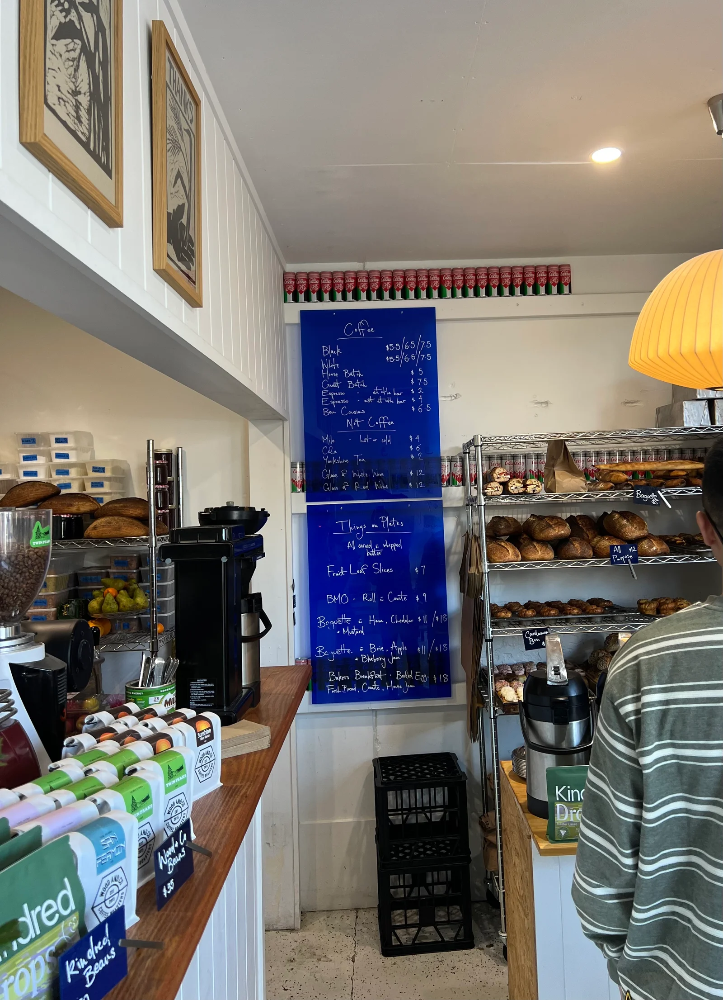
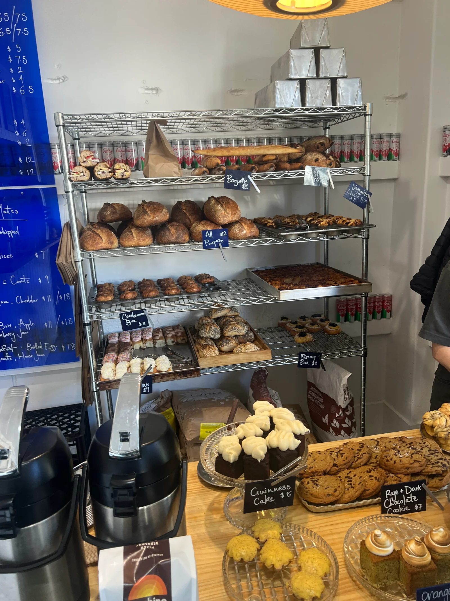
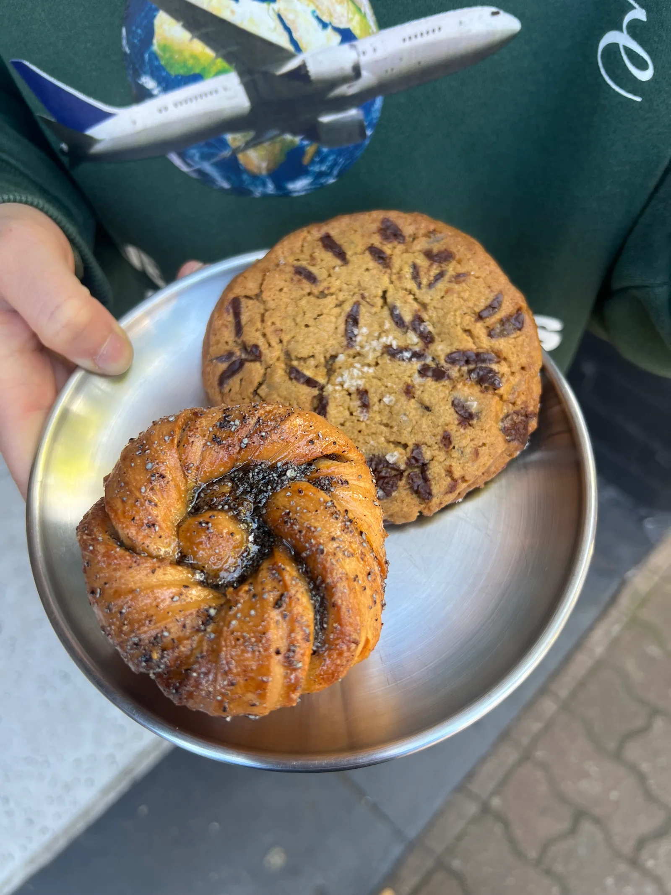
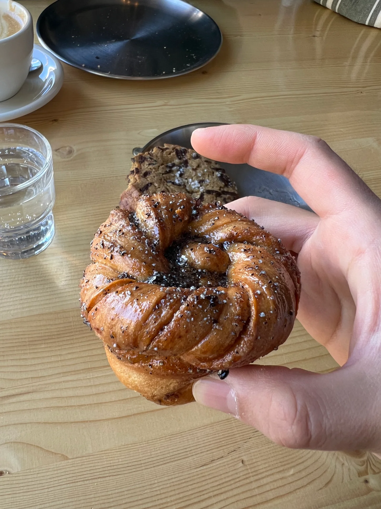
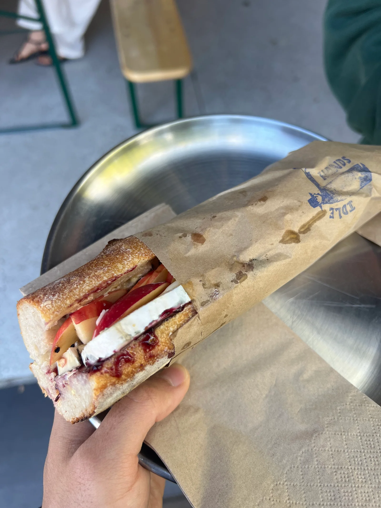
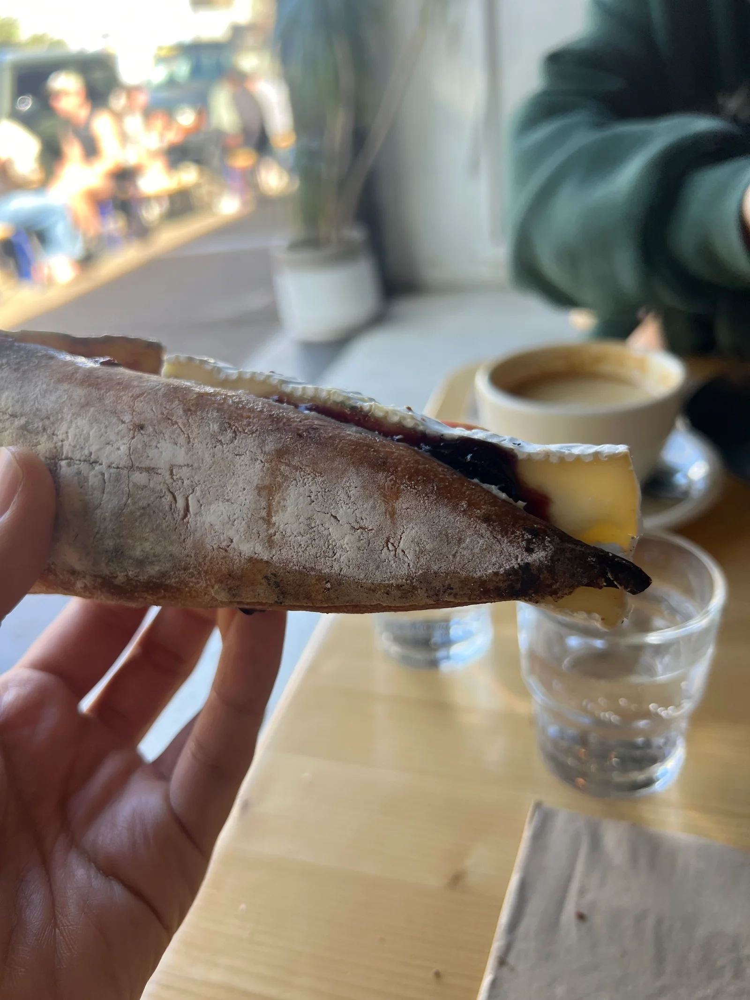
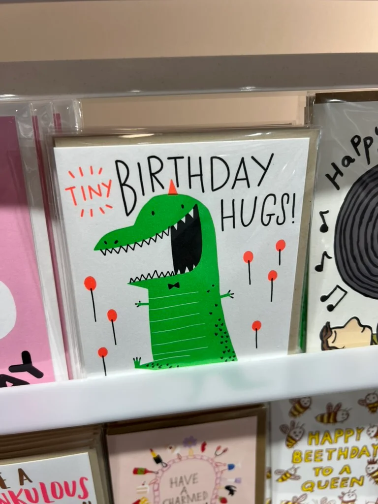

import Video from '../../../components/Video.astro';

## 주말엔 카페

Idle Hands. 같이 일하는 친구가 최애 커피집이라고 추천해줘서 갔다.

구글맵을 훑어보니까 시나몬 번이 있다. 정확히 말하면 꼬아놓은 모양의 knot인 거다. 우리에겐 멜번에서 시나몬 번에 관한 환상적인 경험을 한 기억이 있기 때문에 그냥 자동으로 방문 트리거가 당겨졌다.

메뉴판.

근데 웬걸, 시나몬 번이 아니라 카다몬 번이었네 🤣.

카다몬 하면 내가 가진 경험은… 스리랑카 음식점에서 씹고 그 강렬한 향에 충격 먹었던 기억이 있는 향신료인데, 그래도 트라이해봤다.

요래 생김.
주문하기 전엔 꽤 작아 보였는데 막상 받아보면 생각보다는 크다.

역시 카다몬… 엄청난 펀치력이다. 아직 따뜻해서 좋았다.

아침으로는 배고플 것 같아서 바게트 샌드위치도 시킴.
애플 / 브리 / 블루베리.

빵이 신선해서 깔끔하게 맛있음.

모양도 재밌다.

카페 뒤엔 가구점도 있다. 생각보다 자리가 많지 않아서 테이블 끝에 다른 사람들과 합석 join했다. 

<Video src="/videos/idle-hands-bubbles.mp4" />

완전 랜덤한 궁금증인데… 왜 탄산수에서 공기 방울은 저 고정된 지점에서만 올라올까.
이따 GPT한테 물어본다…

멜버른 느낌 나고 즐거운 하루였다.