import AppleMusicButton from '../../../components/AppleMusicButton.astro';

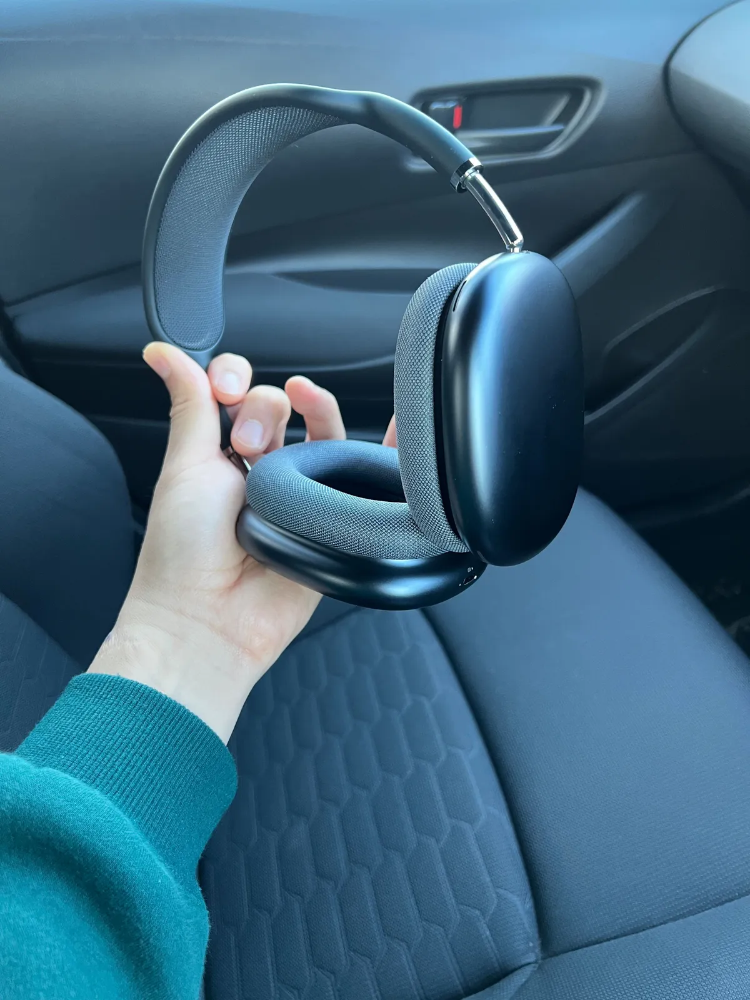

## Why?

I'd been happily using my original AirPods Max 1 (the Lightning version) for the past five years. Cosmetically, the headband has stretched out a bit and the coating has peeled, and the connection sometimes drops in a strange way when I tilt my head back or shift the Max around, but none of that really got in the way.

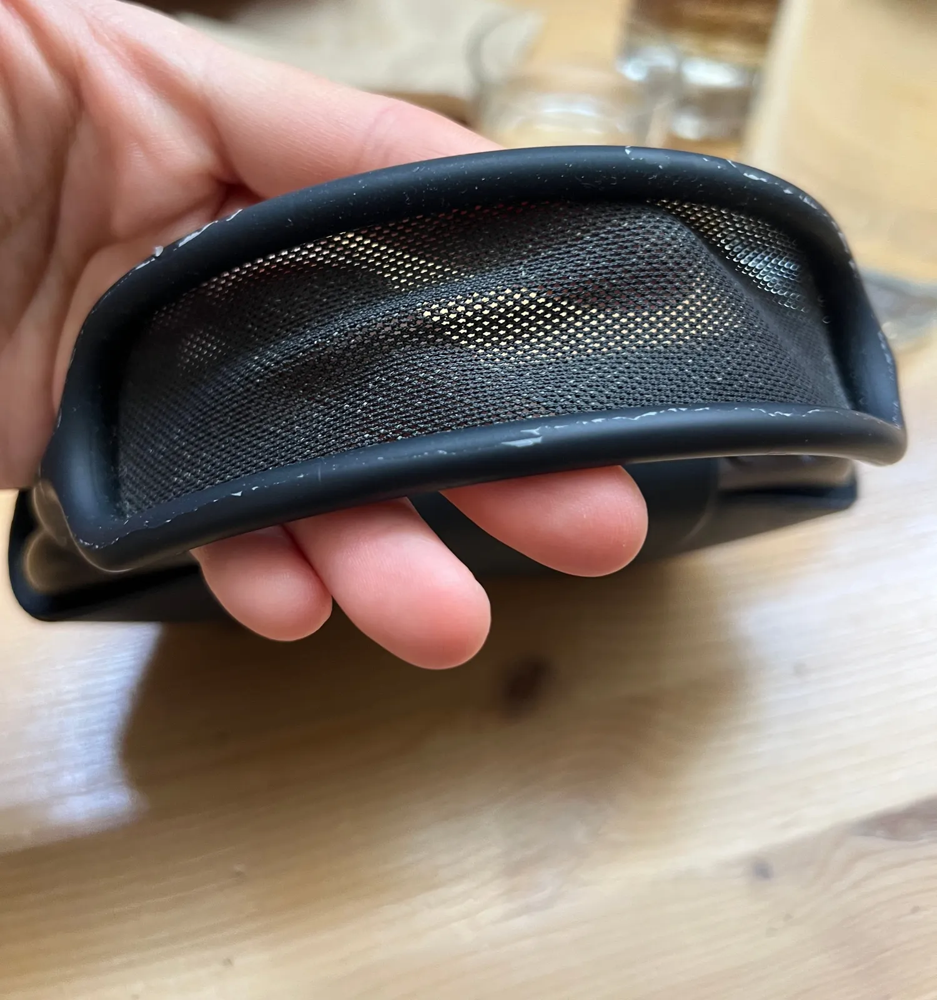
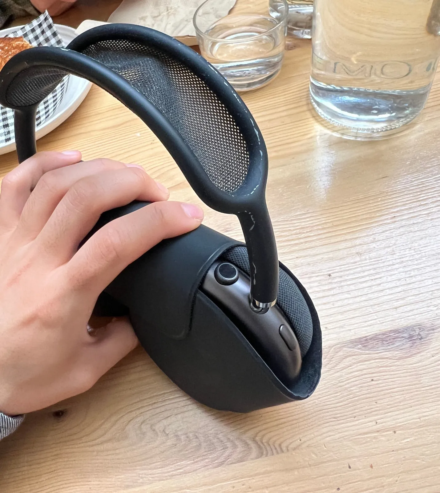

*Cosmetic wear on the Max 1*

And the sound still satisfied me. For five years, these headphones were my dependable... safe haven? I love, love, love working in cafés (going to a café in the morning is the part of the day I look forward to most), and when I open my MacBook there and put these on, my own world opens up.

The second generation came out this year, and the thought of wanting it crossed my mind now and then. Recently I went to an Apple Store, listened for myself, liked what I heard, and took the plunge.

 

## Sound quality

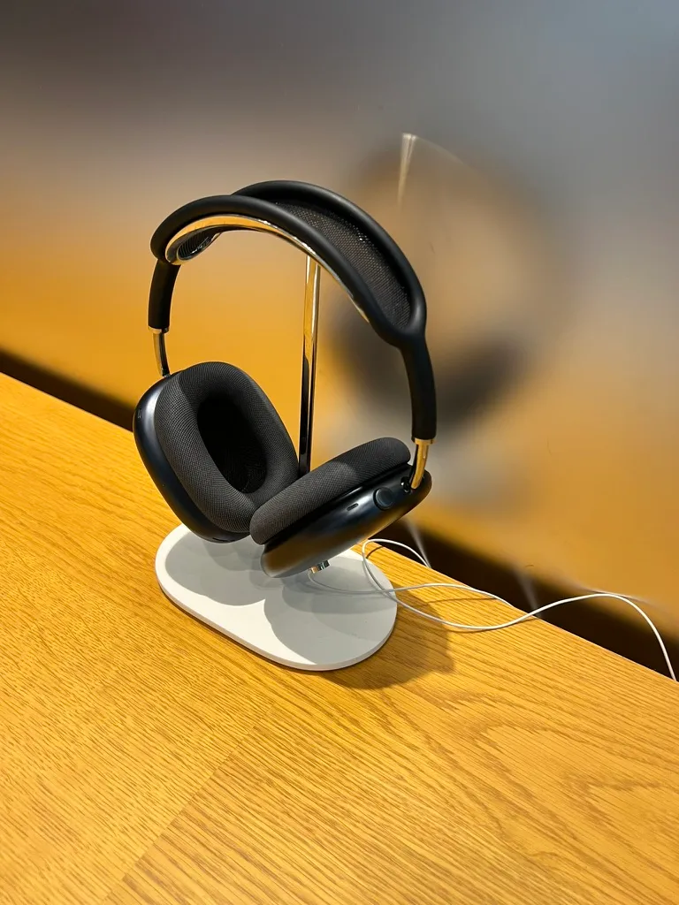

Before buying, I watched a few (okay, a lot of) review videos. Some YouTubers said they couldn't hear much of a difference, but when I tried it myself at the Apple Store, the difference was very clear to me. The low end, which was already tight, is handled even more cleanly, and the separation is better. Above all, thanks to the improved mids and highs, it's as if the headroom has opened up: even with Spatial Audio off, there's this wide-open feeling above my head. On the Max 1, the highs were a bit shaved off, so it felt like there was a ceiling right over me. Now the ceiling is gone, and the sound spreads freely upward too. Put another way, I can turn the volume way up and my ears don't hurt!

As for the sound overall... what can I say, it's so good. I honestly wonder if anything could sound better. A friend asked, "Couldn't you get high-end headphones for that money?" But popular music is now made with AirPods as a reference point, so if I want the headphones that creators check their work on, this feels like exactly the product for me. If you see music as connecting with artists from another world, then I think of these as reference headphones that serve as one channel for it.

 

## Apple - an electronics company?

I've heard people react with, "Does it make sense to pay $750 for headphones from Apple, which isn't even an audio company?" Hmm...

- Logic Pro (music production)
- Apple Digital Masters (mastering oversight)
- iTunes (distribution)
- Apple Music (streaming)
- ALAC (their own lossless codec)
- iPod
- Beats

There has never been a time when this company wasn't serious about sound.

 

## First impressions

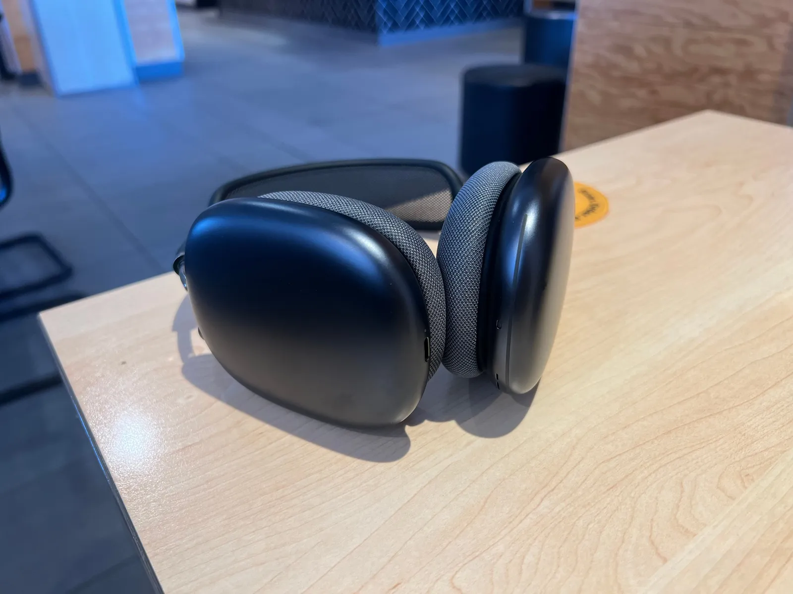

Day one - it looks closer to navy. Is this really "Midnight"?

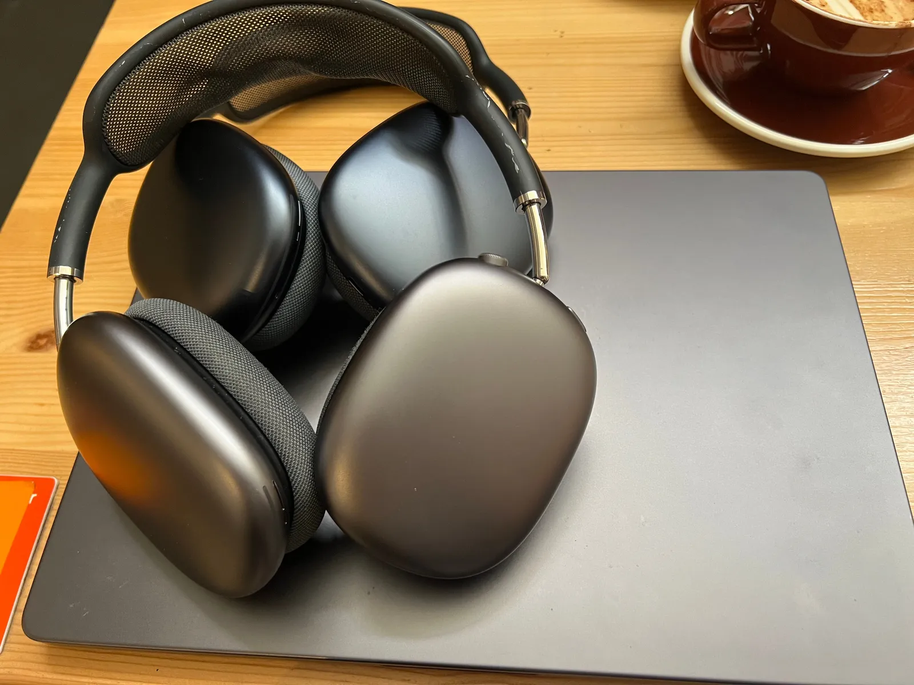

The next day - why does my Max 1 look so yellow? (The background is an M4 Pro MacBook)

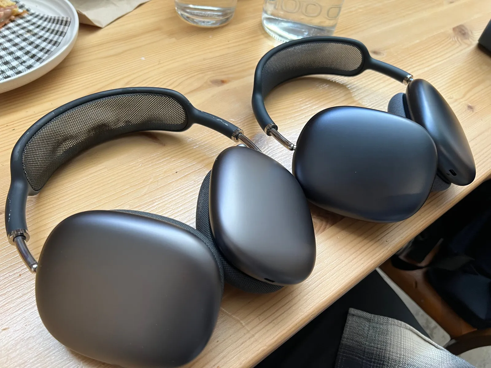

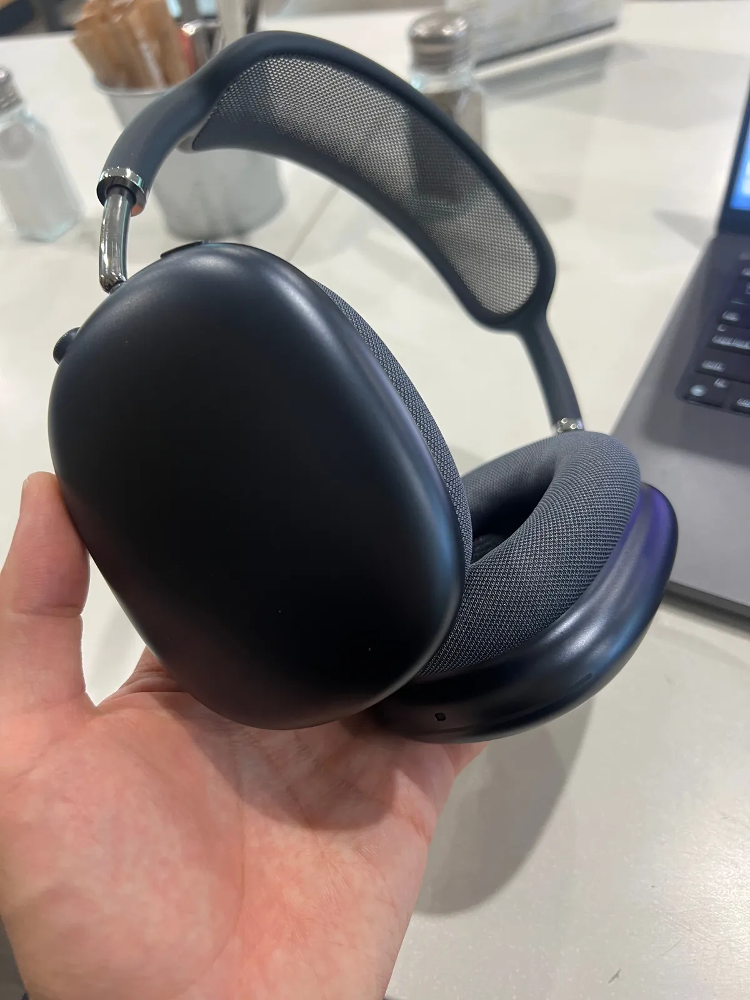

It IS Midnight!! lol
The surface is so smooth that it shows different colors depending on the light, and I'm pleased with that. It looks classy. Though maybe I'm just smitten.

 

## Wired connection

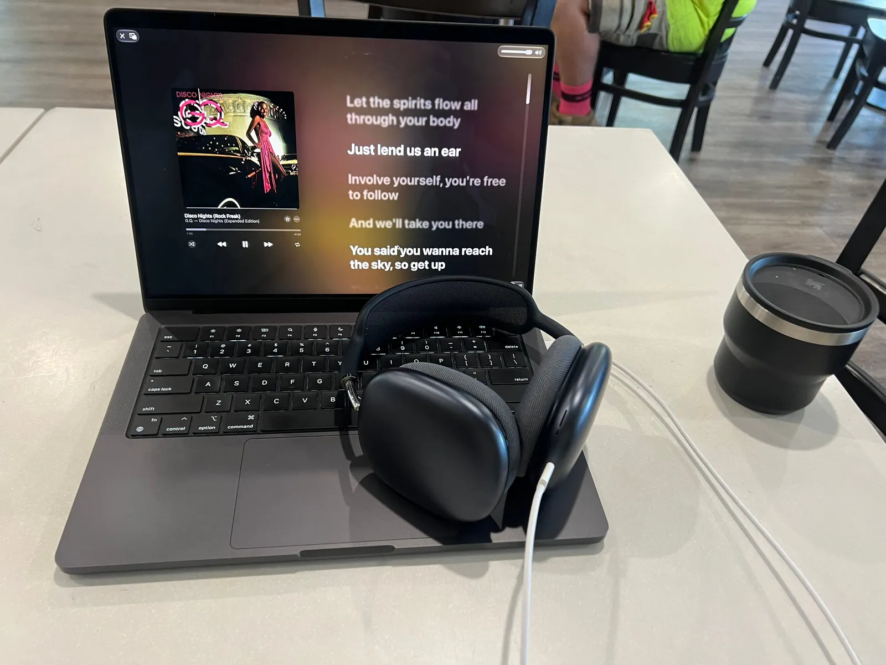

- Cable management - I used to listen to my Max 1 over Lightning &lt;-&gt; 3.5 mm too, but I don't need that anymore! The MacBook's 3.5 mm jack is on the left, while the port on the AirPods is on the right ear cup, so the cable had to run across me and kept getting in the way. Now I just plug USB-C into the right side of the MacBook, the cable stays on the right, and working is much easier.
- Sound - Lightning to 3.5 mm added an extra stage of audio processing, so I could feel the character of the sound change a bit and get softer. This wired connection, maybe because it's digital, reduces that hazy quality typical of Bluetooth, but the sound signature is almost identical to Bluetooth, so some of the... fun? of going wired is gone.
- The attention to detail is insane - if you yank the cable from the Mac while music is playing, it cuts out for 0.2 seconds, jumps straight to Bluetooth, and the music carries on. They even thought of this???
- Turning the Crown controls the device's own volume. That sounds obvious, but with the old 3.5 mm jack, the volume on the computer and the volume on the AirPods Max were separate.

 

## The H2 chip is good

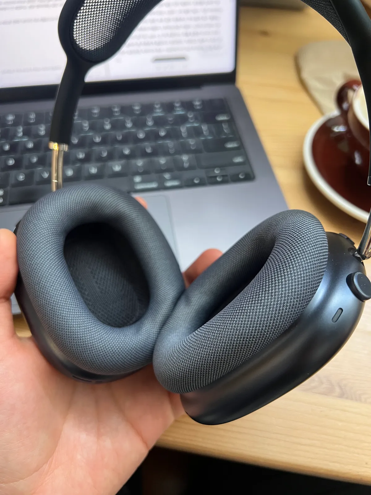

Adaptive noise cancelling sits somewhere between Transparency and noise cancelling. On my AirPods Pro 3, having to squeeze the stem twice to get from Transparency to noise cancelling felt awkward. Here I just press the button twice, and it became second nature really quickly. I like that.

 

## The port - a downgrade?

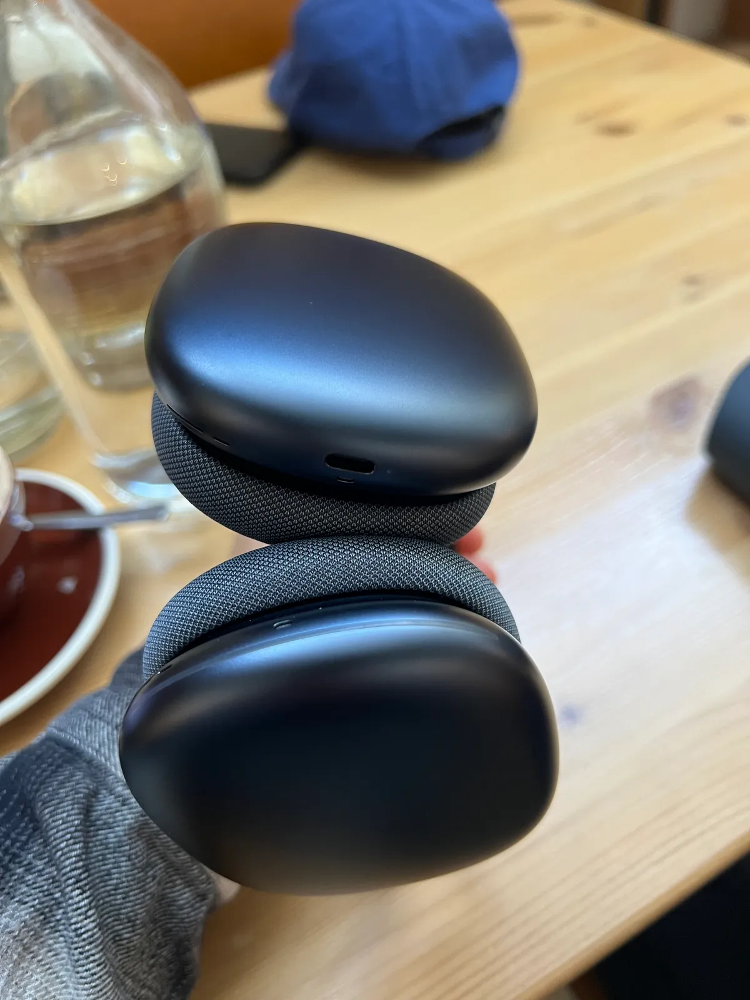

USB-C is great and all, but I don't like how it feels to plug in. Lightning may not have been great for compatibility, but its blunt tip slid in smoothly and felt nice. This one has that metal-on-metal friction, which is a shame. (Although it seems to be getting smoother the more I use it.) USB-C is the standard, so it's not Apple's fault. Honestly, I think Lightning was good in its own peculiar way. What worries me is that there's already something like ground-down powder on the tip of the connector. I hope this lasts me another five years.

 

## Weight

Maybe it's because I have a fairly big head, but above all, the AirPods Max don't feel that heavy to me. That's not to say they're light. I'm... grateful? for my big head. Once I put them on and focus, I forget the weight. They do get a bit humid inside, though, so I take them off for a moment about once an hour.

 

## Other small changes

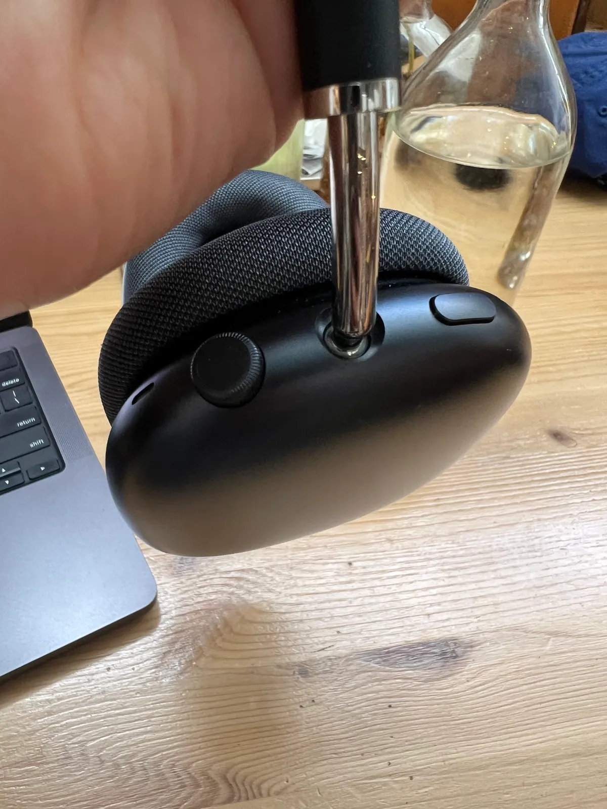

- The buttons press in a bit deeper.
- The headband feels softer
- Swiveling the ear cups feels weightier.

 

## The competition

I ruled out Sony and Bose because I could still hear that hazy quality typical of Bluetooth headphones... I don't know why. My guess is there's some special sound processing in the Apple Music - iPhone - AirPods combination. I did try Sennheiser, though, and it sounded really good. Still, it was more "comparable to AirPods," and it cost a bit more than the Max (without the convenience features, too).

 

## Isn't a new model coming?

My biggest worry was this: the H2 chip is already four years old, so what if that lighter model, rumored every single year, really does come out soon? But this model only launched in May this year, and I saw that the sales are far too small for Apple to rush out a next-generation lightweight AirPods Max (apparently around 1 percent of all AirPods sales),
and this is Apple, which released the HomePod in 2018 and still hasn't changed its design, and is especially conservative about redesigns.. blah blah.., anyway, I wanted it, so I bought it!!

 

## Price

Honestly, it stings. But there are no headphones that can replace it. People say it's heavy, but given that it's aluminium, I can't really complain. So I got the biggest discount I could at Officeworks, with their 5% price beat on Amazon's sale price. I asked Claude, and it said Apple products have thin margins, so they may well have sold it very close to wholesale price, or even at a loss.

*Officeworks price - though when I checked yesterday during Black Friday, it had dropped to $788. That's already the lowest price around, so it looks like the 5% price beat wouldn't apply.*

*Price beat receipt - thank you, Officeworks…*

 

## Recommended tracks

No need to be picky, everything just sounds good.
I used to sort songs into ones that suit Spatial Audio and ones that don't, but on these headphones, even with it off by default, a sense of space forms so naturally on everything. If I had to pick, K-pop generally doesn't seem to go well with Spatial Audio, so I'd recommend things like band music, where the instruments separate naturally. Listening to Prince's 1999 on these, I can't help but marvel.

<AppleMusicButton href="https://music.apple.com/gb/album/1999-remastered/1479564716" label="Listen to Prince - 1999 (Remastered)" />

 

## Verdict

Highly recommended.
