import AppleMusicButton from '../../../components/AppleMusicButton.astro';

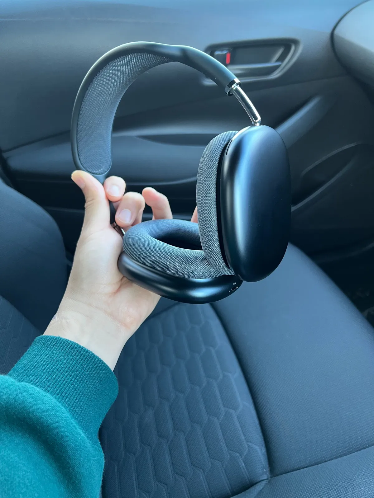

## 왜?

기존 에어팟맥스 1 (라이트닝버전) 을 지난 5년간 잘 사용해 왔다. 코스메틱하게 헤어밴드가 좀 늘어지고 코팅이 벗겨지긴 했고, 고개를 젖히거나 맥스 포지션을 옮기면 이상하게 연결이 끊기는 일이 종종 있지만 그래도 사용에 큰 지장은 없었다.

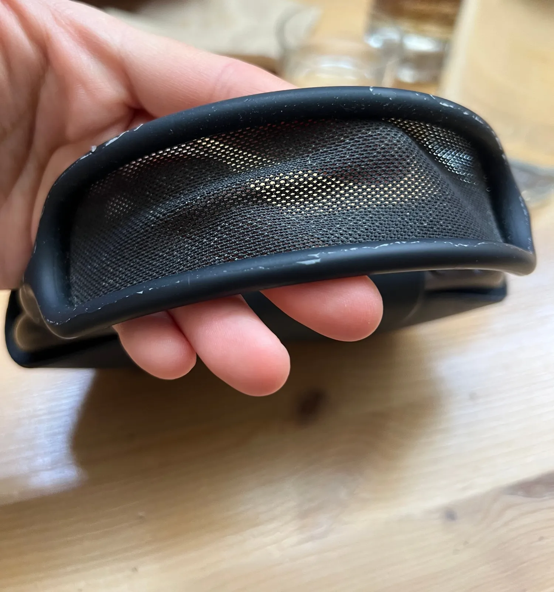
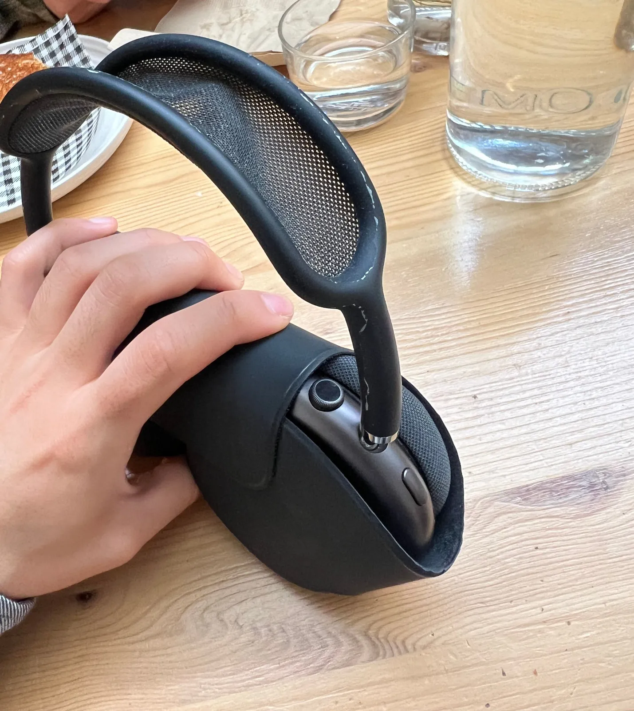

*맥스 1 cosmetic wear*

근데 이게 음질이 여전히 만족스럽고 지난 5년동안 든든한 내 안식처? 가 되어준 헤드폰이었다. 나는 카페등에서 작업하는걸 너무너무너무 좋아하기때문에 (아침에 카페가는 시간이 가장 기다려지는 시간이다.) 카페에서 맥북 열고 이 헤드폰 끼면 내 세상이 열린다.

올해 2세대가 출시되었고 갖고싶다는 생각은 종종 했었는데 최근에 애플 스토어에가서 직접 청음해보니 마음에 들어 큰맘먹고 업그레이드했다.

 

## 음질

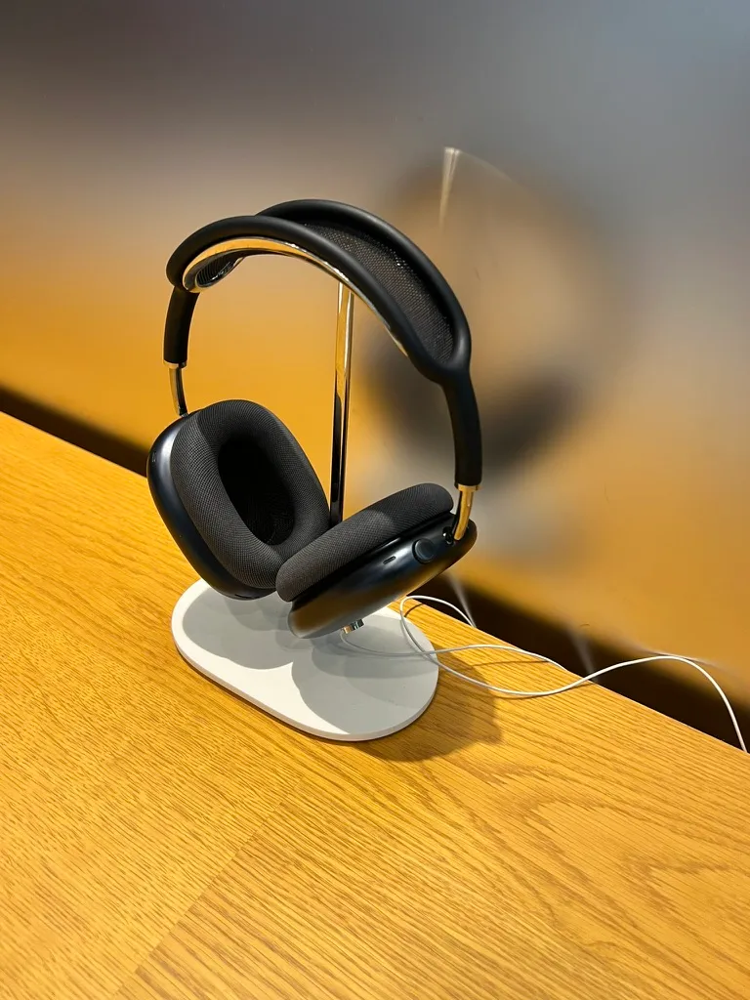

구매하기전에 몇몇 (사실 엄청많이) 리뷰영상을 봤는데 몇몇 유튜버들은 음질 차이가 별로 안느껴진다고하는데 내가 직접 애플 스토어에 갔을때 나는 소리차이가 많이 느껴졌다. 이미 타이트했던 저음쪽 처리가 더 깔끔해졌고 소리분리도가 좋아졌다. 무엇보다 향상된 중 고음 성능덕에 마치 헤드룸? 이 열려서 공간음향을 켜지 않아도 머리 위쪽으로 소리가 열려있는 탁트인 느낌이 든다. 기존 맥스1 에서는 고음이 좀 깎이면서 천장이 내 머리 위에 있는 느낌이었는데, 이제는 천장없이 소리가 쭉 자유롭게 위로도 퍼지는 느낌이 든다. 다른 말로는 음량을 높이 올려도 귀가 안 아프다!

전체적인 소리야 뭐.. 너무 좋다. 이것보다 나은 소리가 있을까 싶을 정도다. 지인 말로는 그 돈이면 하이엔드 헤드폰 살수있지 않냐는데, 애초에 대중음악이 에어팟들을 기준으로 만들어지는 시대라, 원작자가 작업할때 참고하는 헤드폰을 쓰려면 오히려 이게 딱 나를 위한 제품이란 생각이 든다. 음악을 어쨌든 다른 세상의 아티스트와 교감이라는 면에서 본다면 하나의 채널 역할을 해주는 레퍼런스 헤드폰이지 않나 싶다.

 

## 애플 - 전자기기회사?

음향 전문 회사도 아닌 애플 헤드폰에 750불을 지불하는게 말이되느냐는 반응을 들었는데 음..

- 로직 프로 (음악 제작)
- Apple Digital Masters (마스터링 관리)
- 아이튠즈 (유통)
- 애플 뮤직 (스트리밍)
- ALAC (자체 무손실 코덱)
- 아이팟
- Beats

이 회사는 음향에 진심이 아니었던 적이 없다.

 

## 첫인상

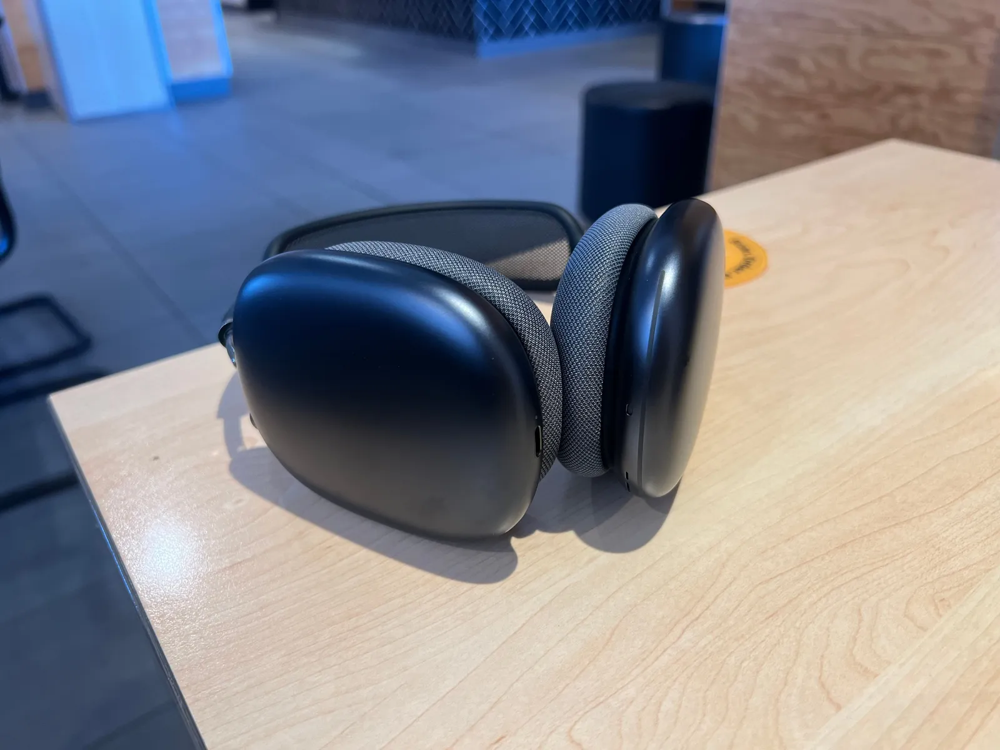

첫날 - 네이비에 더 가까워 보이는데 한밤중(미드 나이트)이 맞나?

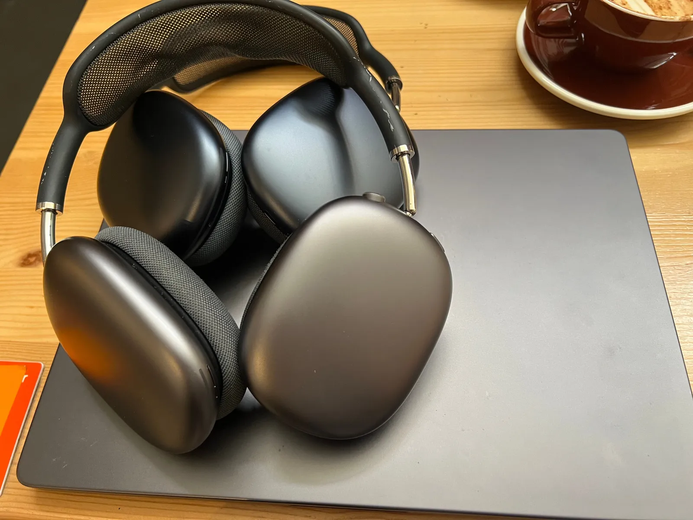

다음날 - 맥스1이 왜이렇게 노랗지? (배경은 맥북 m4 pro 모델)

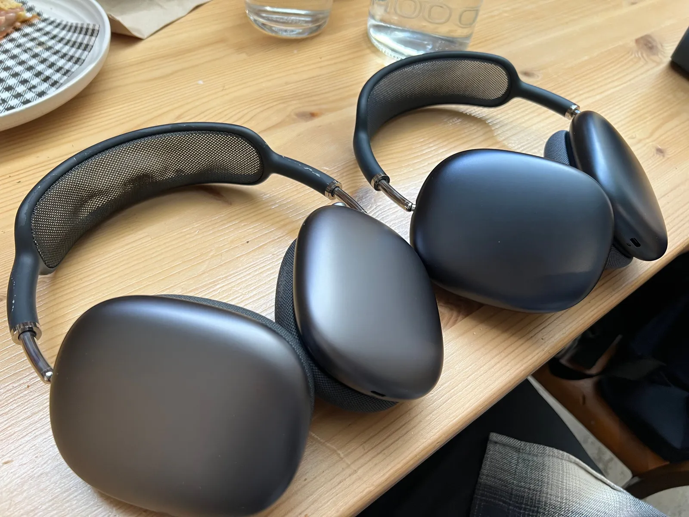

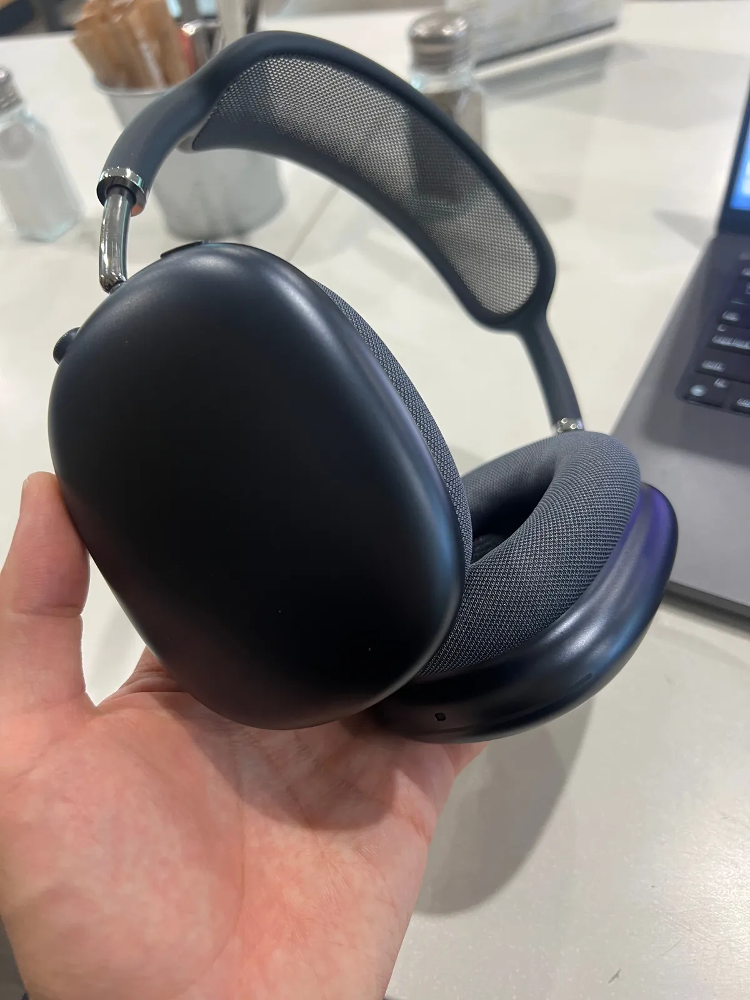

미드나이트 맞네!! ㅋㅋㅋ
표면이 매끈해서 빛에 따라 여러 색이 보이는데 만족스럽다. 고급스럽다. 콩깍지인걸수도 있다.

 

## 유선 연결

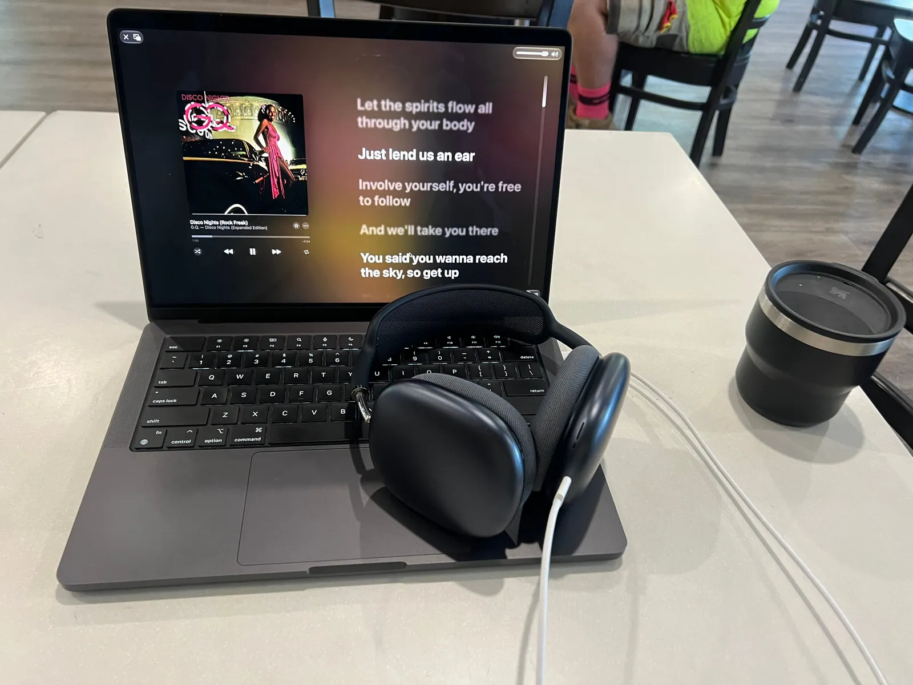

- 선정리 - 기존 맥스 1도 Lightning &lt;-&gt; 3.5 에 연결해서 들었는데 이제는 필요없다! 맥북의 3.5 파이잭은 왼쪽에 꽂아야하고, 에어팟은 오른쪽 헤드컵에 포트가 있어서 선이 가로질러 연결해서 이게 걸리적거려 불편했다. 근데 이제 usb-c 연결을 맥북의 오른쪽에 연결하면 줄이 오른쪽에만 머무르니 작업이 쉬워졌다.
- 음질 - lightning - 3.5 는 추가 음악 processing 이 들어가서 소리 특성이 좀 달라지고 부드러워지는 게 체감되었는데 이 유선 연결은 디지털 방식이라 그런지 블루 투스 특유의 안개끼는 느낌은 줄어드는 효과가 있고 소리 특성은 블루투스와 거의 동일해서 유선 연결의 재미?는 줄어들었다.
- 디테일 미쳤다 - 음악 재생중에 맥과 유선 연결을 강제로 해제하면 0.2초 끊기고 바로 블루투스에 연결해서 음악이 이어진다. 이걸 생각했단 말이야???
- 크라운 돌리면 기기 자체의 음량이 조절된다. 당연한거긴한데 기존 3.5 잭으로하면 기기 / 에어팟 맥스의 자체 음량컨트롤이 분리되어 있었음.

 

## H2칩, 좋다

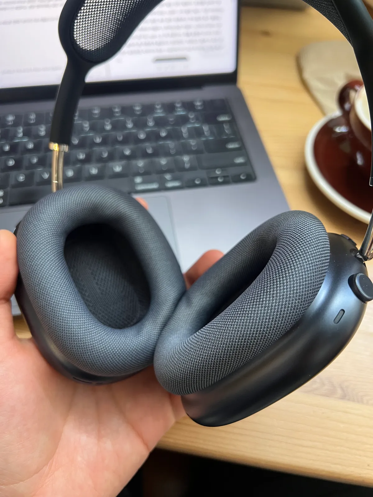

adaptive noise cancelling 은 transparency 랑 노캔 모드의 중간인데 기존 에어팟 프로3 에서 스탬을 두번 꼬집어야 transparency 에서 노캔 모드로 넘어가는게 어색했는데, 이제는 그냥 두번 버튼을 눌러주면 되니까 엄청 금방 자연스러워서 좋다.

 

## 포트 - 다운그레이드?

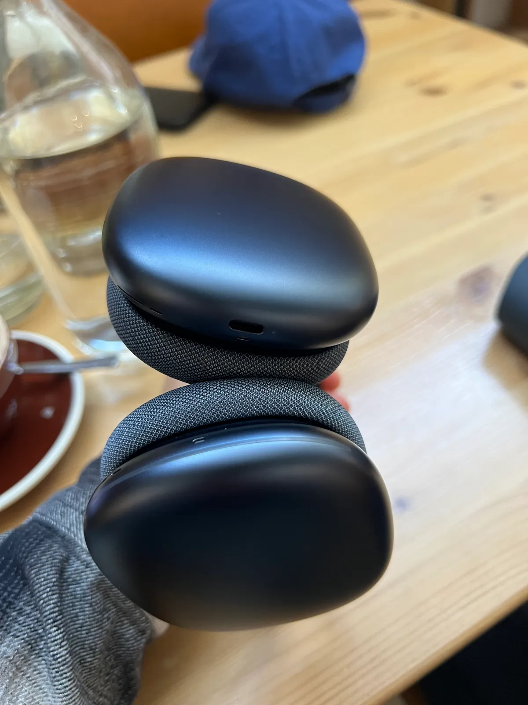

usb-c 인건 좋은데 이거 포트 집어 넣는 맛이 별로다. 기존 라이트닝이 호환성은 별로더라도 충전 포트 끝이 뭉툭하고 부드럽게 꽂기 좋았는데 이건 좀 금속 특유의 마찰이 느껴지는것은 아쉽다. (근데 쓰다보니 점점 부드러워지는 듯) usb-c 는 뭐 표준이니, 애플 잘못은 아니다. 라이트닝이 솔직히 좀 독특하게 좋았다고 생각한다. 걱정인건 벌써 이 포트 끝에 뭔가 갈린듯한 파우더가 묻는 느낌인데 이거 5년 추가로 잘 썼음 좋겠다.

 

## 무게

무엇보다 나는 머리가 큰편이라그런지 에어팟 맥스가 그닥 안 무겁다. 가볍다는건 아님. 큰 머리에 감사?하다. 쓰고 집중하면 무게는 잊는다. 근데 습기는 좀 차는 편이라 1시간에 한번은 잠깐씩 벗어준다.

 

## 그외 약간 달라진점

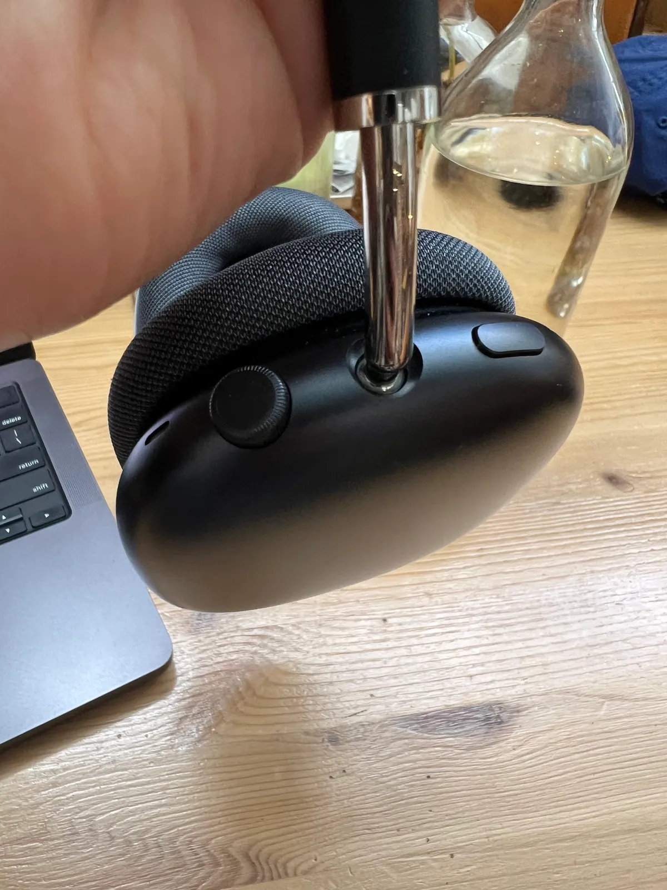

- 버튼들이 좀 더 깊게 눌린다.
- 헤드밴드 부드러워졌다
- 헤드컵 돌리는거 더 묵직해졌다.

 

## 경쟁사모델

소니나 보스는 그 블루투스 헤드폰 특유의 안개낀듯한 느낌이 여전히 느껴져서 제외.. 이유는 모르겠음. 내가 유추하기론, 애플뮤직 - 아이폰 - 에어팟 조합의 특수한 음질 처리가 있는게 아닌가 싶다. 근데 젠하이저는 체험해봤는데 소리가 매우 좋았다. 근데 에어팟이랑 비교할만하다 정도였고 가격은 맥스보다 좀 더 비쌌음(편의기능도 없고).

 

## 신모델 나오는거 아냐?

가장 걱정되었던 건 H2 칩이 나온지 4년이 지났고 매해 돌아오는 경량화 모델이 정말 곧 나오면 어쩌지? 하는 거였다.. 근데 이 모델도 올해 5월 출시했고, 애플이 차세대 경량 에어팟 맥스 출시하기엔 너무 판매량이 적다는 사실을 보고 (에어팟 전체의 1퍼센트 정도 판매량이라는듯),
홈팟도 2018년도에 나오고 지금까지 디자인 안바꾸는, 특히나 디자인 개편에 보수적인 애플이라.. blah blah.., 하튼 갖고싶어서 샀다!!

 

## 가격

솔직히 부담이 된다. 근데 대체할 헤드폰이 없다. 무겁다지만 알루미늄 소재의 특성을 감안하면 뭐 불평할게 없다. 그래서 오피스워크에서 아마존 할인 판매 가격에 5% 프라이스 비트받아가면서 최대한 할인을 받았다. 클로드 한테 물어보니 애플 제품은 마진이 얇아서, 아마 도매가격에 매우 가깝거나 손해보며 팔았을 가능성도 있다고.

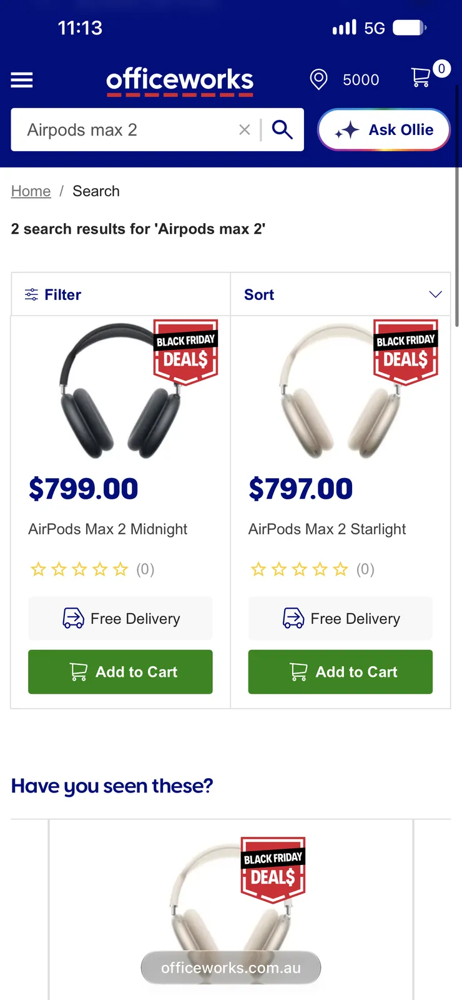

*오피스워크 가격 - 근데 어제 블랙프라이데이때 보니까 788 불로 내렸는데 최저가라서 5% price beat 는 못받는 가격인듯.*

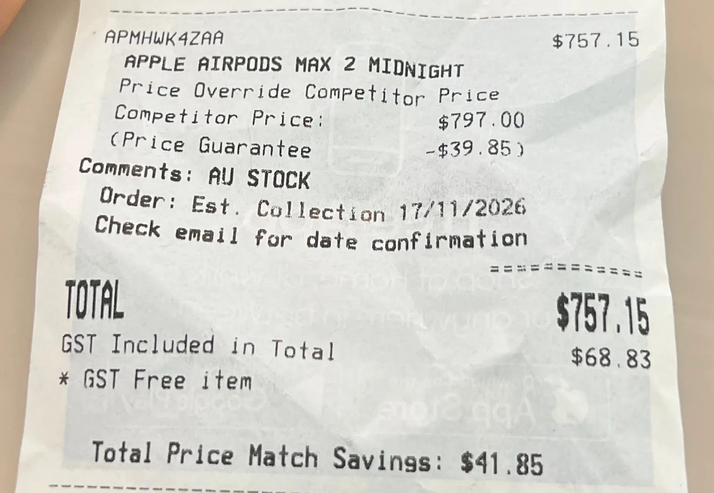

*Price beat 영수증 - 감사합니다 오피스웍스…*

 

## 추천곡

가릴것 없이 그냥 다 좋다.
예전에는 공간음향이 어울리는 곡 과 안어울리는곡을 나눠서 들었는데 이 헤드폰에서는 일단 기본값으로 끄고 들어도 공간감이 다들 워낙 자연스럽게 형성되어 있다. 그래도 굳이 꼽자면 kpop 계열은 보통 공간음향이랑 잘 안어울리는듯하고 밴드음악같이 악기 분리가 자연스럽게 되는 곡을 추천한다. 프린스 1999 를 이거로 들으면 감탄이 절로 나온다.

<AppleMusicButton href="https://music.apple.com/gb/album/1999-remastered/1479564716" label="Prince - 1999 (Remastered) 듣기" />

 

## 결론

강추.
