import AppleMusicButton from '../../../components/AppleMusicButton.astro';

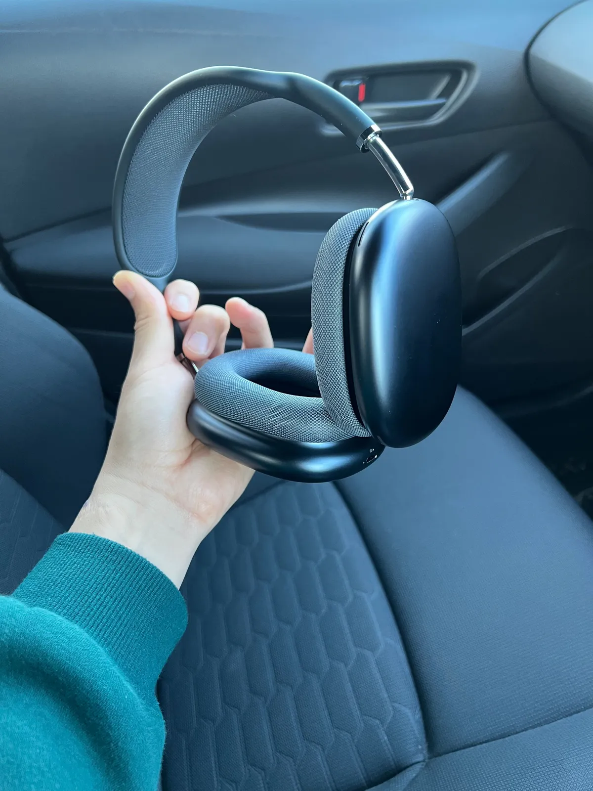

## ทำไมถึงเปลี่ยน?

ห้าปีที่ผ่านมาฉันใช้ AirPods Max 1 รุ่นเดิม (รุ่น Lightning) มาอย่างดี สภาพภายนอกคือแถบคาดศีรษะยืดย้วยไปหน่อย ผิวเคลือบก็ลอก แล้วเวลาเงยหัวหรือขยับตัว Max บางทีการเชื่อมต่อก็หลุดแบบแปลก ๆ แต่ก็ไม่ได้เป็นปัญหาใหญ่ในการใช้งาน

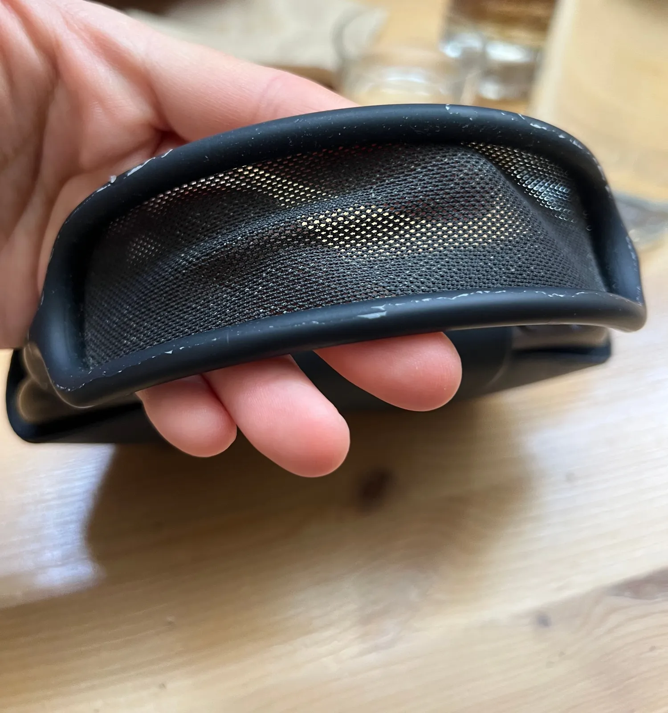
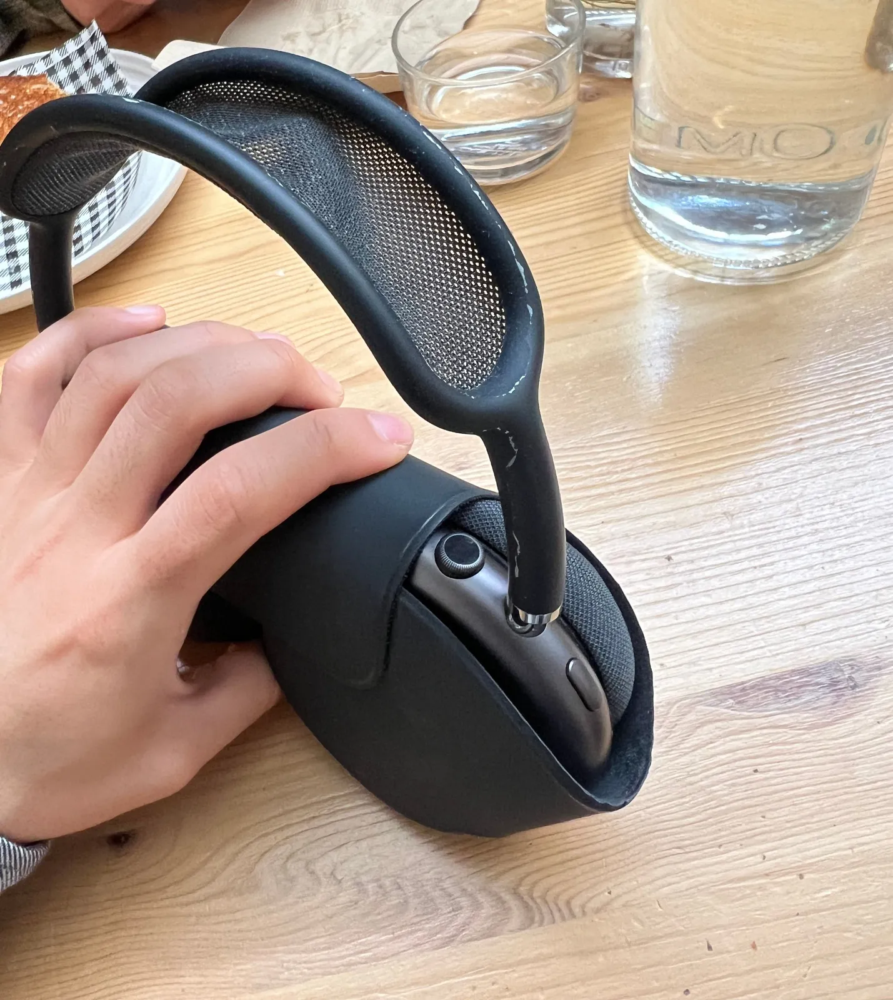

*ร่องรอยการใช้งานภายนอกของ Max 1*

แต่เสียงของมันก็ยังทำให้ฉันพอใจ และตลอดห้าปีมันเป็นหูฟังที่เป็น... ที่พักใจ? ที่พึ่งได้ของฉัน ฉันชอบนั่งทำงานตามคาเฟ่มาก มาก มาก ๆ (ช่วงที่รอคอยที่สุดคือการไปคาเฟ่ตอนเช้า) พอเปิด MacBook ในคาเฟ่แล้วสวมหูฟังตัวนี้ โลกของฉันก็เปิดออก

ปีนี้รุ่นที่สองออกมา ฉันก็คิดอยากได้อยู่เรื่อย ๆ จนเมื่อไม่นานมานี้ไปลองฟังเองที่ Apple Store แล้วถูกใจ เลยตัดสินใจทุ่มทุนอัปเกรด

 

## คุณภาพเสียง

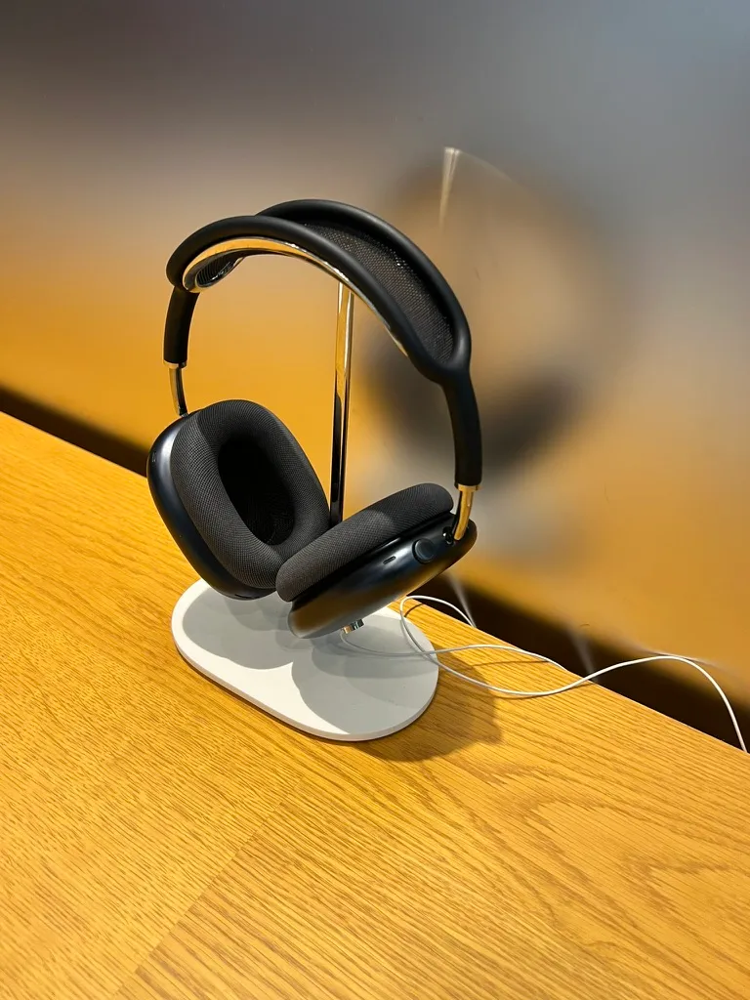

ก่อนซื้อฉันดูคลิปรีวิวมาบ้าง (จริง ๆ คือเยอะมาก) ยูทูบเบอร์บางคนบอกว่าแทบไม่รู้สึกว่าเสียงต่างกัน แต่ตอนที่ฉันไปลองเองที่ Apple Store ฉันรู้สึกได้เลยว่าเสียงต่างกันมาก ย่านเบสที่แน่นอยู่แล้วจัดการได้สะอาดขึ้นอีก การแยกชิ้นเสียงก็ดีขึ้น ที่สำคัญที่สุดคือย่านกลางและแหลมที่ดีขึ้นทำให้เหมือน headroom เปิดออก ถึงไม่เปิด Spatial Audio ก็รู้สึกว่าเสียงเปิดโล่งอยู่เหนือหัว ใน Max 1 เดิมเสียงแหลมเหมือนโดนเฉือนไปหน่อย ให้ความรู้สึกว่ามีเพดานอยู่เหนือหัว แต่ตอนนี้ไม่มีเพดานแล้ว เสียงกระจายขึ้นข้างบนได้อย่างอิสระ พูดอีกแบบคือเร่งเสียงดังแค่ไหนก็ไม่เจ็บหู!

ส่วนเสียงโดยรวมน่ะเหรอ.. ดีมาก ๆ ดีจนสงสัยว่าจะมีเสียงที่ดีกว่านี้อีกไหม คนรู้จักถามว่า เงินขนาดนั้นซื้อหูฟังไฮเอนด์ได้ไม่ใช่เหรอ แต่ยุคนี้เพลงป๊อปถูกทำขึ้นโดยอิง AirPods เป็นมาตรฐานอยู่แล้ว ถ้าอยากใช้หูฟังที่เจ้าของผลงานใช้อ้างอิงตอนทำเพลง ฉันว่าตัวนี้แหละคือของที่เหมาะกับฉันพอดี ถ้ามองว่าดนตรีคือการสื่อถึงกันกับศิลปินจากอีกโลกหนึ่ง นี่ก็น่าจะเป็นหูฟังอ้างอิงที่ทำหน้าที่เป็นช่องทางหนึ่งของมัน

 

## Apple - บริษัทอุปกรณ์อิเล็กทรอนิกส์?

ฉันเคยได้ยินคนถามว่า จ่าย 750 ดอลลาร์ให้หูฟังของ Apple ที่ไม่ใช่บริษัทเครื่องเสียงโดยเฉพาะ มันสมเหตุสมผลเหรอ อืม..

- Logic Pro (ทำเพลง)
- Apple Digital Masters (การดูแลมาสเตอริง)
- iTunes (จัดจำหน่าย)
- Apple Music (สตรีมมิง)
- ALAC (โคเดก lossless ของตัวเอง)
- iPod
- Beats

บริษัทนี้ไม่เคยไม่จริงจังกับเรื่องเสียง

 

## ความประทับใจแรก

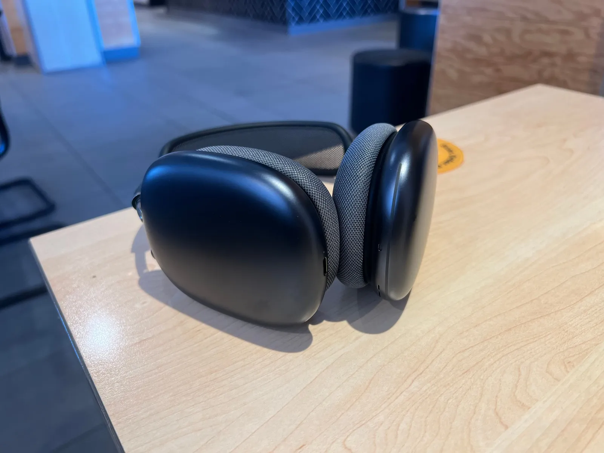

วันแรก - ดูออกไปทางสีกรมท่ามากกว่า นี่ใช่ "เที่ยงคืน" (Midnight) จริงเหรอ?

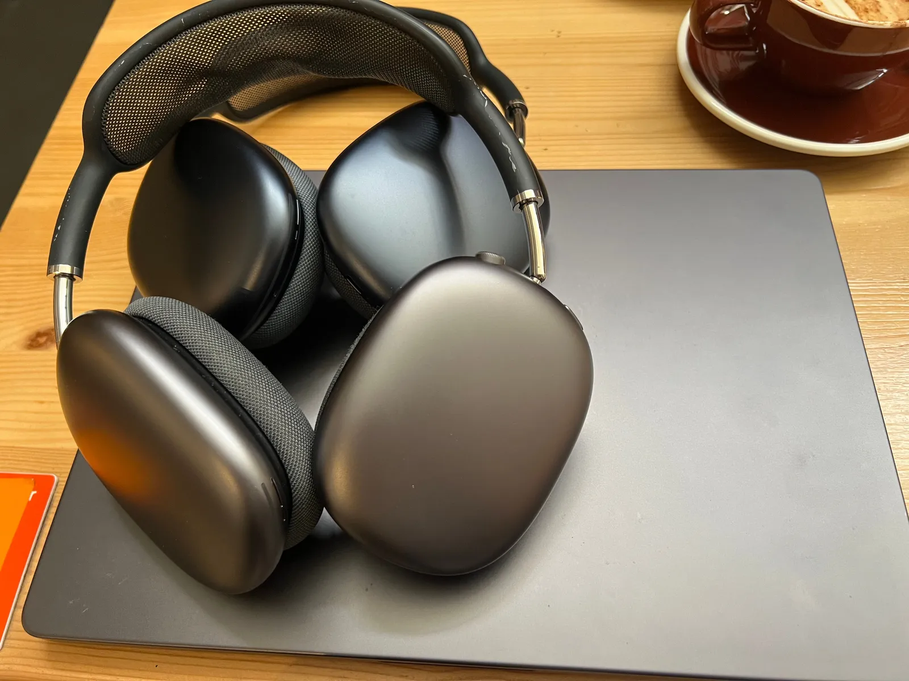

วันถัดมา - ทำไม Max 1 ดูเหลืองขนาดนี้? (ฉากหลังคือ MacBook รุ่น M4 Pro)

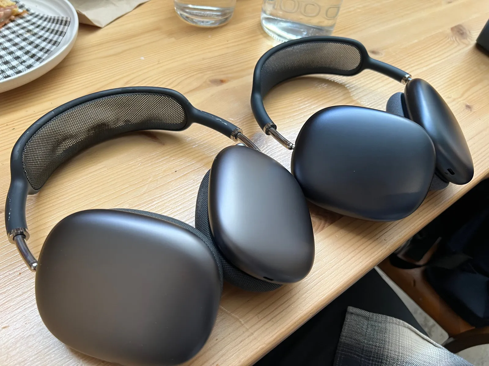

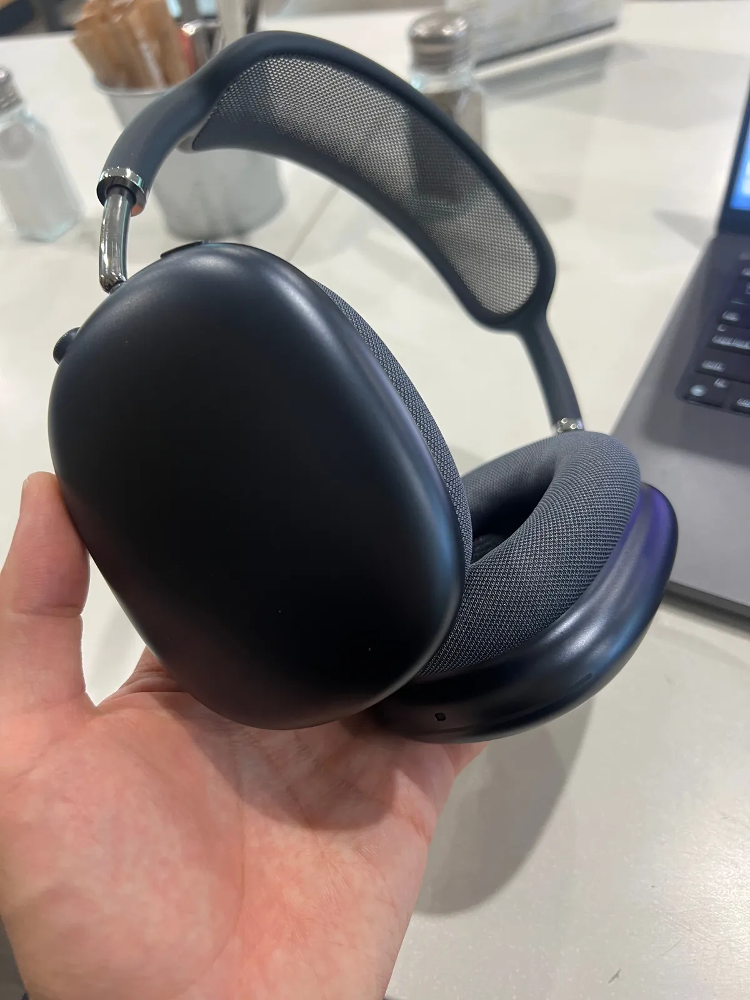

Midnight จริงด้วย!! 5555
ผิวมันเรียบเนียน เลยเห็นได้หลายสีตามแสง ถูกใจมาก ดูหรูดี หรืออาจจะแค่หลงจนมองอะไรก็ดีก็ได้

 

## การต่อสาย

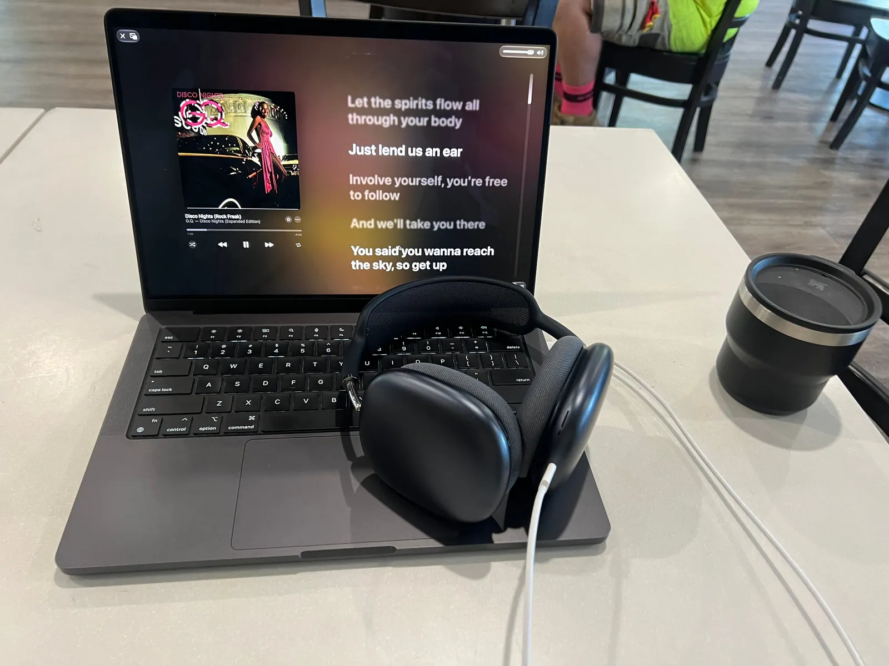

- จัดสาย - ตอนใช้ Max 1 ฉันก็ต่อ Lightning &lt;-&gt; 3.5 mm ฟังเหมือนกัน แต่ตอนนี้ไม่ต้องแล้ว! ช่อง 3.5 mm ของ MacBook อยู่ด้านซ้าย ส่วนพอร์ตของ AirPods อยู่ที่ครอบหูข้างขวา สายเลยต้องพาดข้ามไปมา เกะกะมาก แต่ตอนนี้เสียบ USB-C เข้าด้านขวาของ MacBook สายก็อยู่แค่ฝั่งขวา ทำงานสะดวกขึ้นเยอะ
- คุณภาพเสียง - Lightning ไป 3.5 mm มีการประมวลผลเสียงเพิ่มอีกชั้น เลยรู้สึกได้ว่าคาแรกเตอร์เสียงเปลี่ยนไปหน่อยและนุ่มลง ส่วนการต่อสายแบบใหม่นี้คงเพราะเป็นดิจิทัล ความรู้สึกขุ่นเหมือนมีหมอกแบบบลูทูธเลยลดลง แต่คาแรกเตอร์เสียงแทบเหมือนบลูทูธเลย ความ... สนุก? ของการต่อสายก็เลยน้อยลง
- ใส่ใจรายละเอียดแบบสุด ๆ - ถ้าดึงสายออกจาก Mac ระหว่างเล่นเพลง เสียงจะขาดไป 0.2 วินาที แล้วสลับไปบลูทูธเล่นต่อทันที คิดถึงเรื่องนี้ด้วยเหรอ???
- หมุน Crown คือปรับระดับเสียงของเครื่องที่ต่ออยู่โดยตรง ฟังดูเป็นเรื่องปกติ แต่ตอนใช้ช่อง 3.5 mm เดิม การปรับเสียงของเครื่องกับของ AirPods Max แยกกัน

 

## ชิป H2 ดีเลย

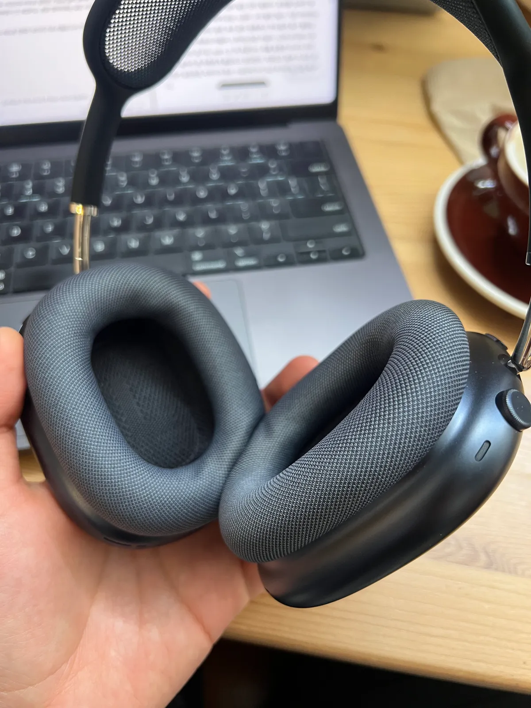

adaptive noise cancelling อยู่กึ่งกลางระหว่างโหมด transparency กับโหมดตัดเสียง บน AirPods Pro 3 ที่ใช้อยู่ การต้องบีบก้านสองครั้งเพื่อสลับจาก transparency ไปโหมดตัดเสียงมันรู้สึกแปลก ๆ แต่ตัวนี้แค่กดปุ่มสองครั้ง เลยชินมือเร็วมาก ชอบ

 

## พอร์ต - ดาวน์เกรด?

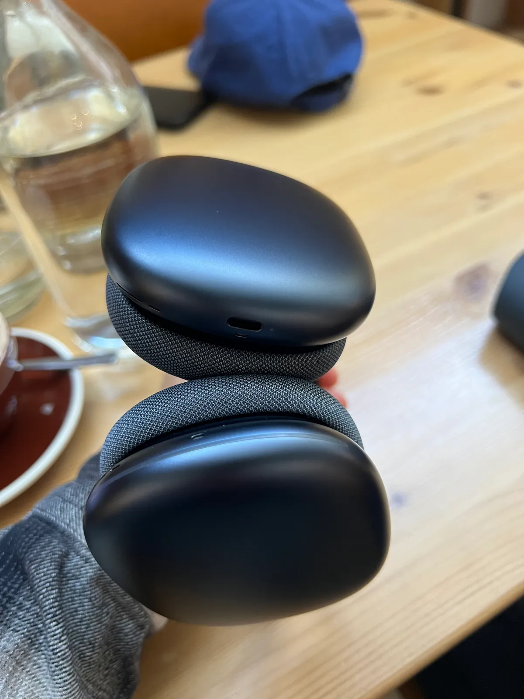

เป็น USB-C ก็ดีอยู่ แต่สัมผัสตอนเสียบไม่ค่อยดี Lightning เดิมถึงเรื่องความเข้ากันได้จะไม่เท่าไร แต่ปลายหัวชาร์จมน ๆ เสียบแล้วนุ่มลื่นดี ส่วนอันนี้รู้สึกถึงแรงเสียดสีแบบโลหะ น่าเสียดาย (แต่ใช้ไปเรื่อย ๆ ก็เหมือนจะลื่นขึ้นนะ) USB-C เป็นมาตรฐาน ไม่ใช่ความผิดของ Apple ว่ากันตามตรง ฉันว่า Lightning มันดีในแบบเฉพาะตัวของมัน ที่กังวลคือตอนนี้ปลายหัวเสียบเริ่มมีผงเหมือนถูกครูดออกมาติดแล้ว หวังว่าจะใช้ได้ดีต่อไปอีกห้าปี

 

## น้ำหนัก

อาจเพราะฉันหัวค่อนข้างใหญ่ ที่สำคัญคือ AirPods Max ไม่ได้รู้สึกหนักเท่าไร แต่ก็ไม่ได้แปลว่าเบานะ ต้อง... ขอบคุณ? หัวใหญ่ ๆ ของตัวเอง พอสวมแล้วมีสมาธิก็ลืมเรื่องน้ำหนัก แต่ข้างในอับชื้นอยู่บ้าง เลยถอดพักแป๊บหนึ่งทุกชั่วโมง

 

## เรื่องเล็ก ๆ อื่นที่เปลี่ยนไป

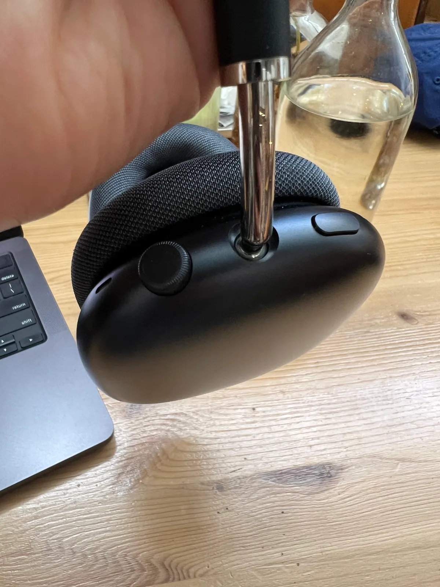

- ปุ่มกดลงได้ลึกขึ้นอีกหน่อย
- แถบคาดศีรษะนุ่มขึ้น
- การหมุนที่ครอบหูหนักแน่นขึ้น

 

## รุ่นของคู่แข่ง

Sony กับ Bose ฉันยังรู้สึกถึงความขุ่นเหมือนมีหมอกแบบหูฟังบลูทูธ เลยตัดออก.. ไม่รู้เหมือนกันว่าทำไม เดาเอาว่าอาจมีการประมวลผลเสียงแบบพิเศษของชุด Apple Music - iPhone - AirPods ส่วน Sennheiser ได้ลองแล้ว เสียงดีมาก แต่ก็อยู่ในระดับเทียบกับ AirPods ได้ และราคาแพงกว่า Max นิดหน่อย (ฟีเจอร์อำนวยความสะดวกก็ไม่มีด้วย)

 

## รุ่นใหม่จะออกไม่ใช่เหรอ?

เรื่องที่กังวลที่สุดคือ ชิป H2 ออกมาสี่ปีแล้ว ถ้ารุ่นน้ำหนักเบาที่ลือกันทุกปีเกิดออกมาเร็ว ๆ นี้จริงจะทำยังไง.. แต่รุ่นนี้ก็เพิ่งออกเดือนพฤษภาคมปีนี้เอง แถมเห็นข้อมูลว่ายอดขายน้อยเกินกว่าที่ Apple จะรีบออก AirPods Max รุ่นเบาเจเนอเรชันถัดไป (เห็นว่าราว 1 เปอร์เซ็นต์ของยอดขาย AirPods ทั้งหมด)
แล้วก็เป็น Apple ที่ออก HomePod ตั้งแต่ปี 2018 และจนตอนนี้ยังไม่เปลี่ยนดีไซน์ ยิ่งเรื่องรื้อดีไซน์นี่อนุรักษ์นิยมเป็นพิเศษ.. blah blah.., เอาเป็นว่าอยากได้ ก็เลยซื้อ!!

 

## ราคา

พูดตรง ๆ ว่าหนักกระเป๋า แต่ไม่มีหูฟังที่มาแทนได้ ใคร ๆ ว่ามันหนัก แต่พอนึกถึงคุณสมบัติของวัสดุอะลูมิเนียมแล้วก็ไม่มีอะไรให้บ่น ฉันเลยเอาส่วนลดให้สุด โดยใช้ price beat 5% ของ Officeworks (ขายถูกกว่าคู่แข่งอีก 5%) เทียบกับราคาลดของ Amazon ลองถาม Claude ดู มันบอกว่าสินค้า Apple กำไรบาง ราคานี้อาจใกล้ราคาส่งมาก หรืออาจถึงขั้นขายขาดทุนก็ได้

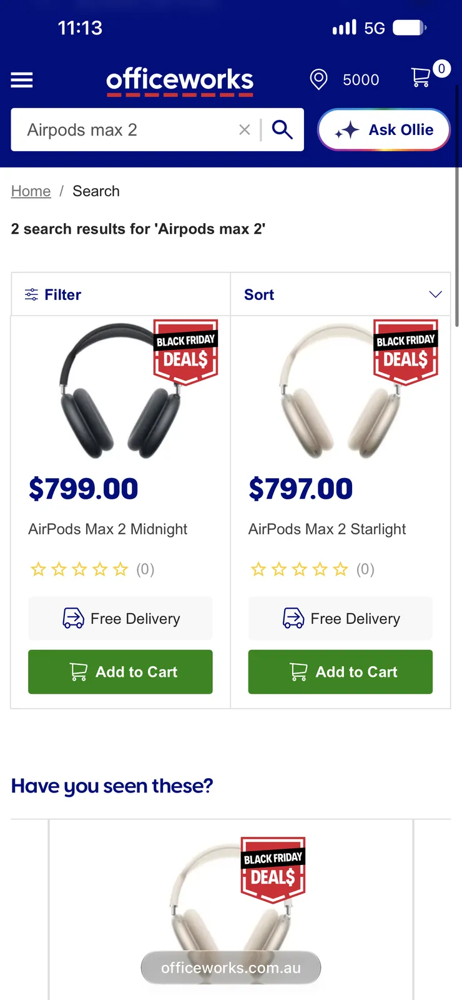

*ราคาที่ Officeworks - แต่เมื่อวานดูช่วง Black Friday ลดเหลือ 788 ดอลลาร์ ซึ่งเป็นราคาต่ำสุดแล้ว เลยน่าจะใช้ price beat 5% ไม่ได้*

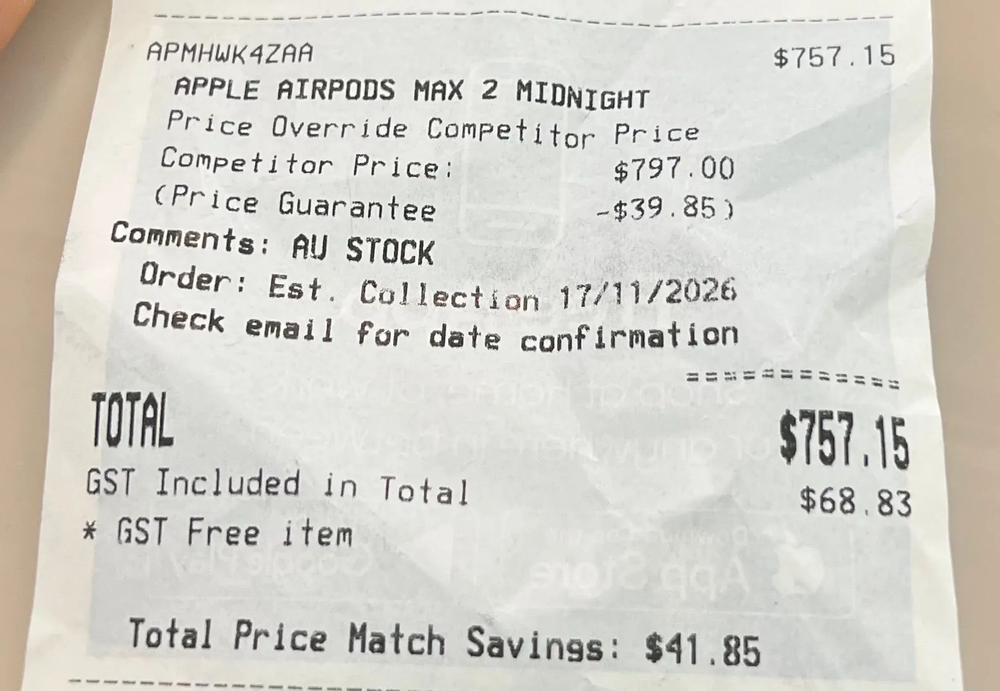

*ใบเสร็จ price beat - ขอบคุณนะ Officeworks…*

 

## เพลงแนะนำ

ไม่ต้องเลือกเลย ดีไปหมด
เมื่อก่อนฉันแยกฟังระหว่างเพลงที่เข้ากับ Spatial Audio กับเพลงที่ไม่เข้า แต่บนหูฟังตัวนี้ ถึงปิดไว้เป็นค่าเริ่มต้น มิติเสียงของทุกเพลงก็เกิดขึ้นอย่างเป็นธรรมชาติมาก ถ้าต้องเลือกจริง ๆ แนว K-pop มักไม่ค่อยเข้ากับ Spatial Audio ฉันแนะนำเพลงที่เครื่องดนตรีแยกชิ้นกันได้เป็นธรรมชาติอย่างเพลงวง ฟัง 1999 ของ Prince ด้วยตัวนี้แล้วต้องอุทานออกมาเลย

<AppleMusicButton href="https://music.apple.com/gb/album/1999-remastered/1479564716" label="ฟัง Prince - 1999 (Remastered)" />

 

## สรุป

แนะนำอย่างยิ่ง
