import AppleMusicButton from '../../../components/AppleMusicButton.astro';

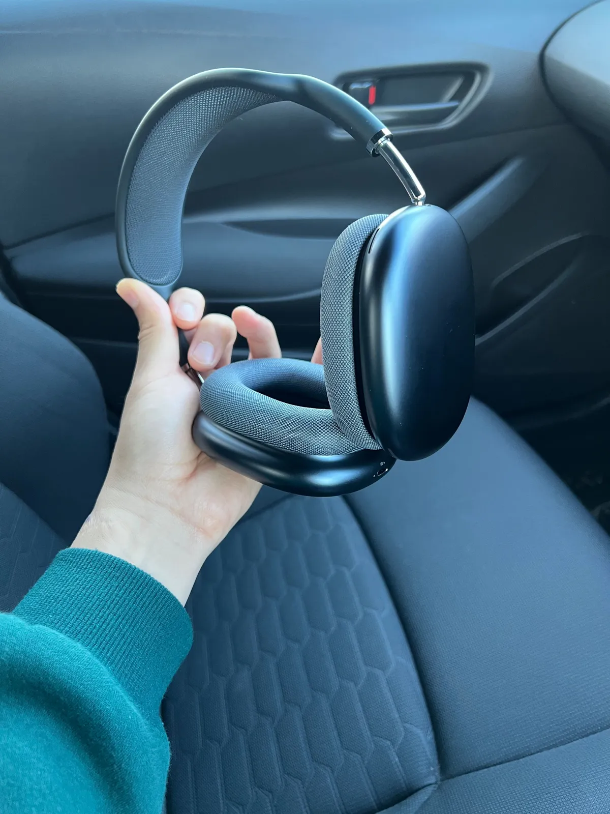

## Vì sao đổi?

Suốt năm năm qua tôi dùng chiếc AirPods Max 1 cũ (bản Lightning) rất ổn. Về ngoại hình thì băng đô hơi giãn, lớp phủ bị tróc, và khi ngửa đầu hay xê dịch chiếc Max thì thỉnh thoảng nó mất kết nối một cách kỳ lạ, nhưng cũng chẳng ảnh hưởng gì nhiều đến việc sử dụng.

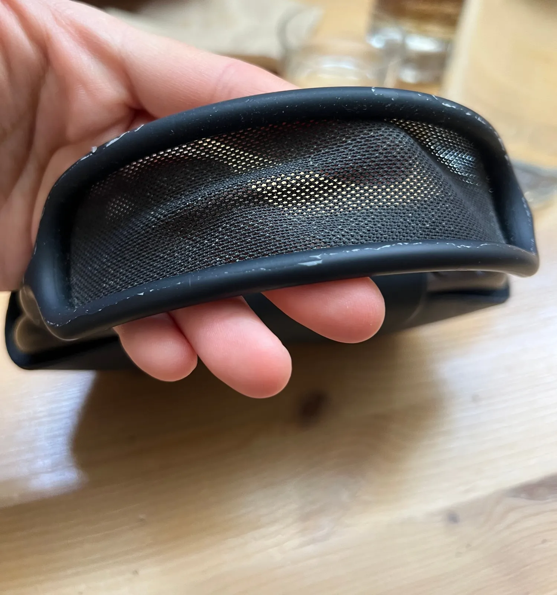
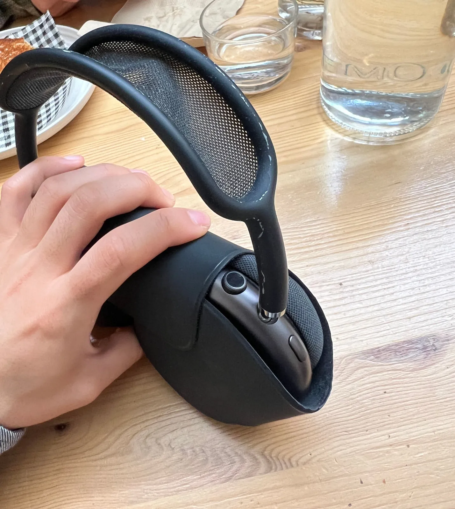

*Hao mòn ngoại hình của Max 1*

Mà chất âm của nó vẫn làm tôi hài lòng, suốt năm năm nó là chiếc tai nghe, là... chốn bình yên? vững chãi của tôi. Tôi cực kỳ, cực kỳ, cực kỳ thích làm việc ở những nơi như quán cà phê (đi cà phê buổi sáng là lúc tôi mong chờ nhất), và khi mở MacBook ở quán rồi đeo chiếc tai nghe này lên, thế giới của tôi mở ra.

Năm nay thế hệ thứ hai ra mắt, thỉnh thoảng tôi cũng nghĩ là muốn có nó. Gần đây tôi đến Apple Store nghe thử tận tai, thấy ưng, nên mạnh tay nâng cấp.

 

## Chất âm

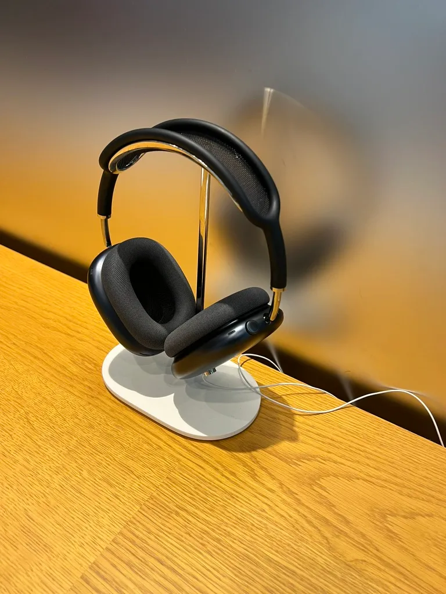

Trước khi mua tôi đã xem một vài (thật ra là rất nhiều) video đánh giá. Một số YouTuber bảo chẳng thấy chất âm khác mấy, nhưng khi tự mình nghe thử ở Apple Store, tôi thấy âm thanh khác rõ rệt. Phần trầm vốn đã chắc nay được xử lý gọn gàng hơn, độ tách bạch cũng tốt hơn. Hơn hết, nhờ dải trung và cao được cải thiện, cứ như headroom được mở ra: không cần bật Âm thanh không gian vẫn có cảm giác thoáng đãng, âm thanh mở rộng lên phía trên đầu. Ở Max 1 cũ, âm cao bị gọt đi một chút nên cảm giác như có trần nhà ngay trên đầu, còn giờ trần nhà biến mất, âm thanh tự do lan cả lên trên. Nói cách khác, vặn âm lượng thật to mà tai không đau!

Còn âm thanh nói chung thì... hay quá. Hay đến mức tự hỏi liệu có gì hay hơn được nữa không. Một người quen bảo, chừng đó tiền thì mua được tai nghe hi-end rồi còn gì. Nhưng thời nay nhạc đại chúng vốn được làm ra với AirPods làm chuẩn, nên nếu muốn dùng chiếc tai nghe mà chính tác giả tham chiếu khi làm nhạc, thì tôi nghĩ đây lại đúng là sản phẩm dành cho mình. Nếu xem âm nhạc là sự giao cảm với những nghệ sĩ ở một thế giới khác, thì chẳng phải đây là chiếc tai nghe tham chiếu đóng vai trò một kênh dẫn sao.

 

## Apple - công ty đồ điện tử?

Tôi từng nghe người ta phản ứng: bỏ 750 đô cho tai nghe của Apple, một hãng đâu chuyên về âm thanh, có hợp lý không? Ừm...

- Logic Pro (sản xuất âm nhạc)
- Apple Digital Masters (quản lý mastering)
- iTunes (phân phối)
- Apple Music (phát trực tuyến)
- ALAC (codec lossless riêng)
- iPod
- Beats

Hãng này chưa bao giờ không nghiêm túc với âm thanh.

 

## Ấn tượng đầu tiên

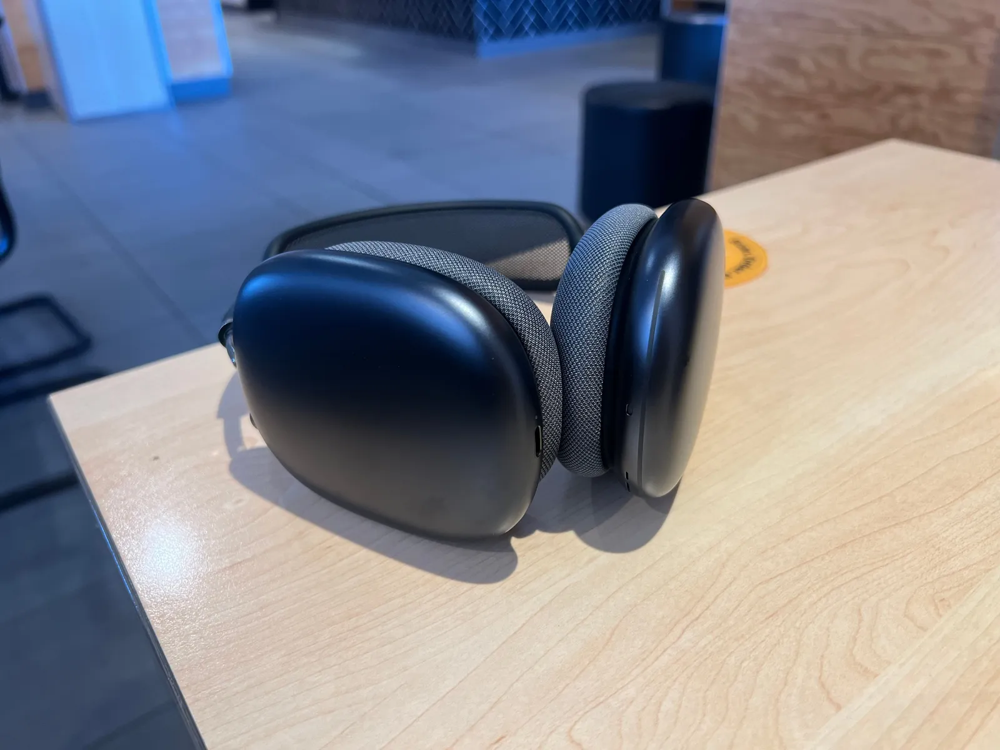

Ngày đầu - trông gần với màu xanh navy hơn, đây có đúng là "nửa đêm" (Midnight) không?

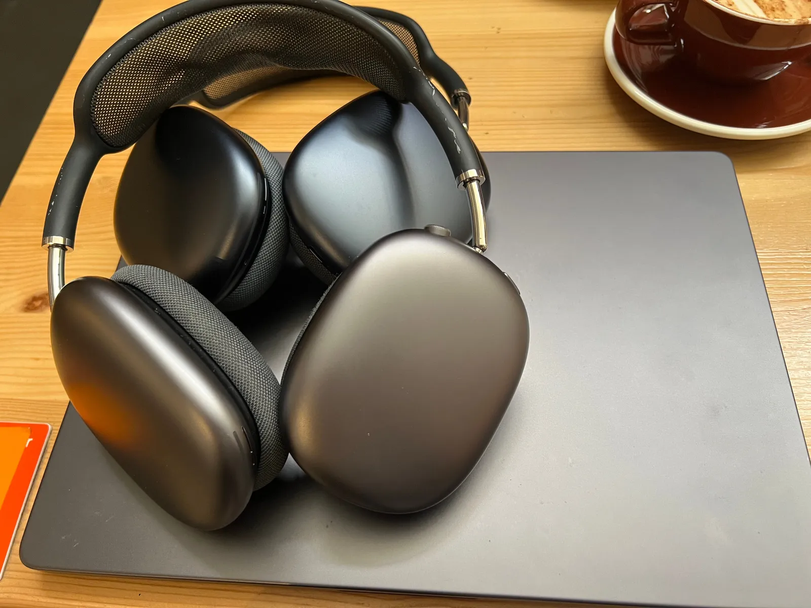

Hôm sau - sao chiếc Max 1 vàng thế này? (phía sau là chiếc MacBook M4 Pro)

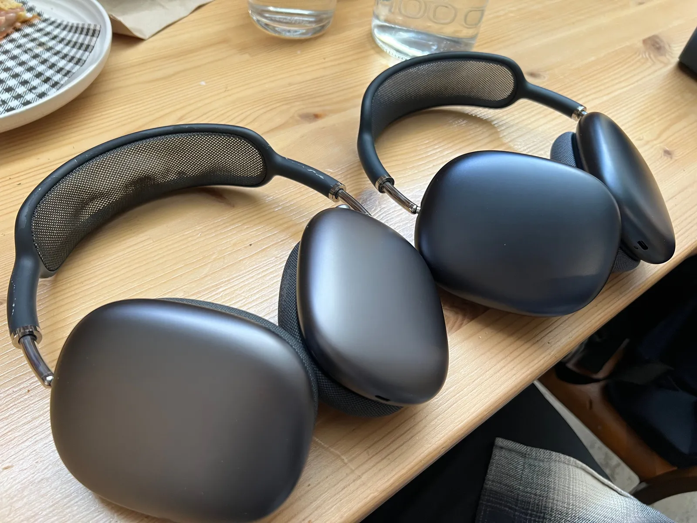

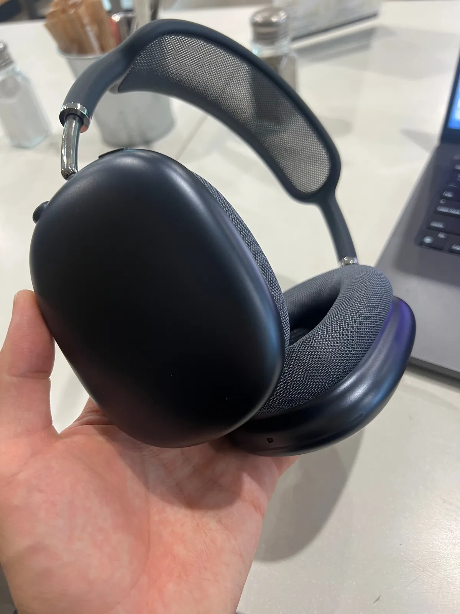

Đúng là Midnight rồi!! haha
Bề mặt bóng mịn nên tùy ánh sáng mà thấy nhiều sắc màu, tôi rất ưng. Sang. Mà cũng có thể là do yêu nên thấy gì cũng đẹp.

 

## Kết nối có dây

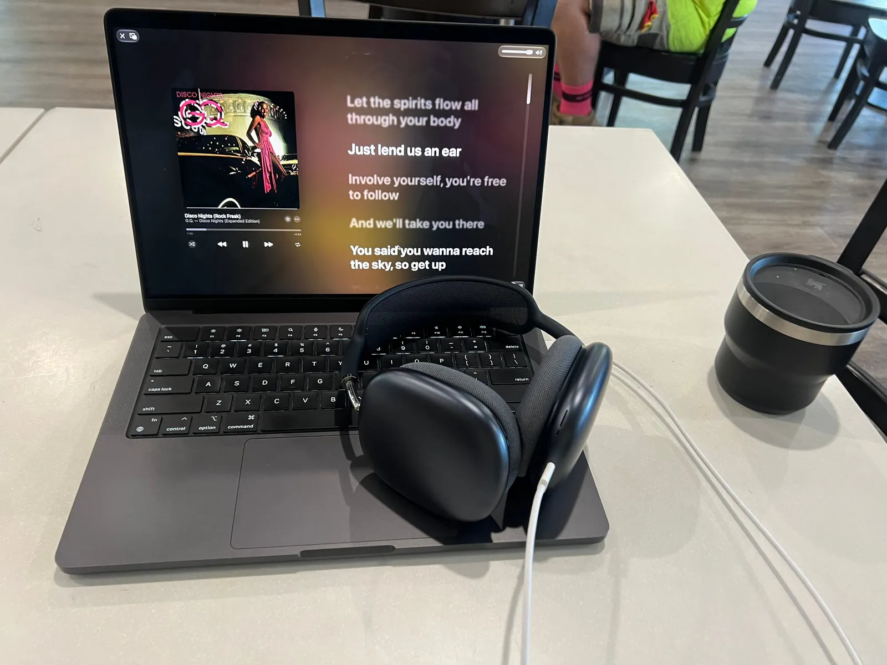

- Gọn dây - hồi dùng Max 1 tôi cũng cắm Lightning &lt;-&gt; 3.5 mm để nghe, giờ thì khỏi cần! Cổng 3.5 mm của MacBook nằm bên trái, còn cổng trên AirPods lại ở củ tai phải, nên dây phải vắt ngang, rất vướng. Giờ chỉ việc cắm USB-C vào bên phải MacBook, dây chỉ nằm bên phải, làm việc dễ chịu hơn hẳn.
- Chất âm - Lightning sang 3.5 mm có thêm một tầng xử lý âm thanh nên tôi cảm nhận được chất âm thay đổi đôi chút và mềm đi. Còn kết nối có dây này, chắc vì là tín hiệu số, nên cái cảm giác mờ đục đặc trưng của Bluetooth giảm đi, nhưng chất âm gần như y hệt Bluetooth, thành ra cái... thú? của việc cắm dây cũng bớt đi.
- Chi tiết đỉnh thật - đang phát nhạc mà giật dây khỏi Mac, âm thanh ngắt 0,2 giây rồi chuyển ngay sang Bluetooth, nhạc chạy tiếp. Đến cái này mà cũng tính trước???
- Xoay núm Crown là chỉnh thẳng âm lượng của thiết bị đang nối. Nghe thì đương nhiên, nhưng hồi dùng giắc 3.5 mm, âm lượng của máy và của AirPods Max được chỉnh riêng.

 

## Chip H2, hay đấy

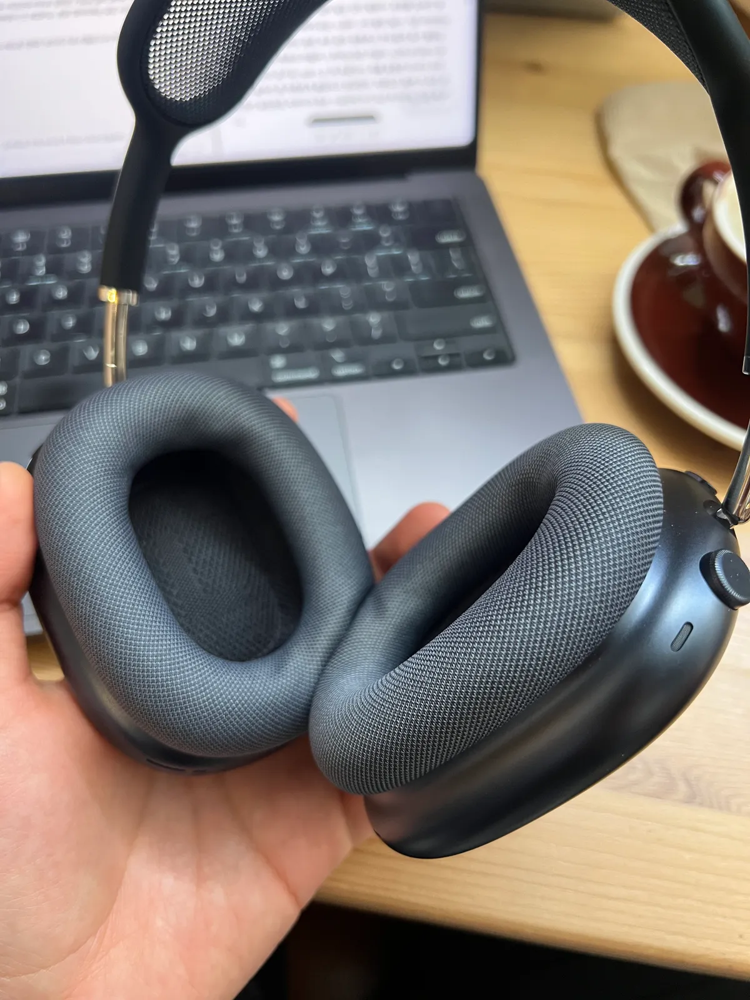

Chống ồn thích ứng nằm giữa chế độ xuyên âm và chế độ chống ồn. Trên chiếc AirPods Pro 3 tôi đang có, phải bóp thân tai nghe hai lần mới chuyển từ xuyên âm sang chống ồn, thấy hơi gượng. Còn giờ chỉ cần bấm nút hai lần là xong nên quen tay rất nhanh, thích.

 

## Cổng sạc - một bước lùi?

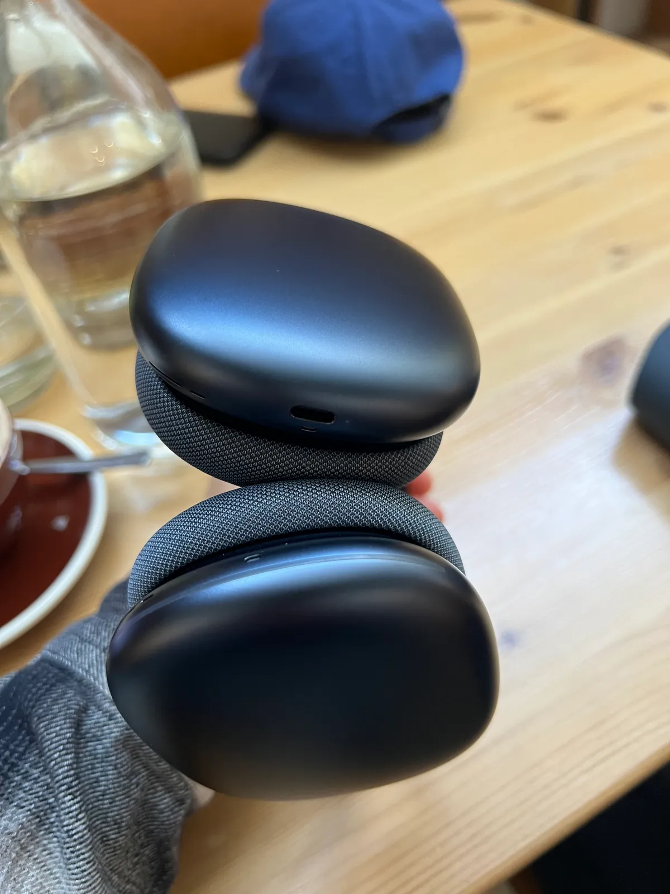

Có USB-C thì tốt, nhưng cảm giác khi cắm vào không sướng lắm. Lightning cũ tuy tương thích kém, nhưng đầu sạc tròn tù, cắm vào êm và mượt, còn cái này thì cảm nhận được độ ma sát đặc trưng của kim loại, hơi tiếc. (Mà dùng một thời gian thì hình như mượt dần.) USB-C là chuẩn chung rồi, chẳng phải lỗi của Apple. Thật lòng tôi thấy Lightning hay theo một kiểu rất riêng. Điều đáng lo là ở đầu cắm đã bám thứ gì như bột bị mài ra, mong là nó còn dùng tốt thêm năm năm nữa.

 

## Trọng lượng

Có lẽ vì đầu tôi khá to, nhưng hơn hết là với tôi AirPods Max không nặng lắm. Không có nghĩa là nó nhẹ. Phải... cảm ơn? cái đầu to của mình. Đeo vào rồi tập trung là quên luôn trọng lượng. Có điều bên trong hơi bí ẩm, nên cứ mỗi tiếng tôi lại tháo ra một lát.

 

## Vài thay đổi nhỏ khác

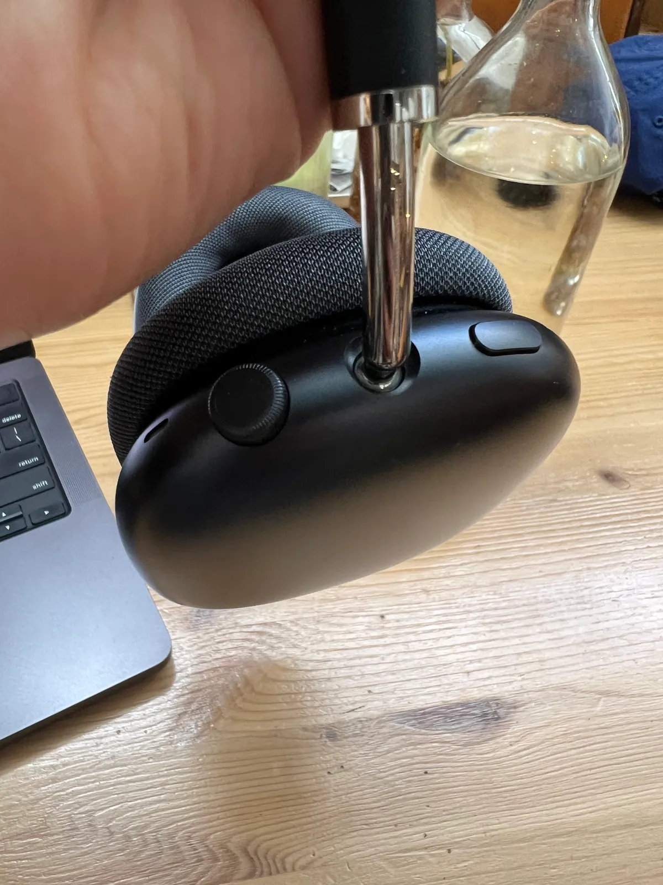

- Các nút bấm lún sâu hơn một chút.
- Băng đô mềm hơn
- Xoay củ tai đầm tay hơn.

 

## Các mẫu đối thủ

Sony và Bose vẫn cho tôi cảm giác mờ đục đặc trưng của tai nghe Bluetooth nên bị loại... Không hiểu vì sao. Tôi đoán là bộ ba Apple Music - iPhone - AirPods có cách xử lý âm thanh đặc biệt gì đó. Nhưng Sennheiser thì tôi đã nghe thử, âm thanh rất hay. Có điều cũng ở mức so được với AirPods, mà giá lại nhỉnh hơn Max một chút (cũng chẳng có các tính năng tiện ích).

 

## Sắp có mẫu mới chăng?

Điều tôi lo nhất là chip H2 ra đã bốn năm rồi, lỡ cái mẫu gọn nhẹ năm nào cũng đồn lại sắp ra thật thì sao?.. Nhưng mẫu này cũng mới ra tháng Năm năm nay, và tôi thấy thông tin rằng doanh số quá ít để Apple vội tung ra thế hệ AirPods Max nhẹ hơn (nghe đâu chỉ khoảng 1% tổng doanh số AirPods),
mà đây là Apple, hãng ra HomePod từ năm 2018 đến giờ vẫn chưa đổi thiết kế, đặc biệt bảo thủ trong chuyện thiết kế lại.. blah blah.., nói chung là muốn có nên mua!!

 

## Giá

Thật lòng là hơi xót ví. Nhưng không có tai nghe nào thay thế được. Người ta bảo nó nặng, nhưng xét đặc tính của vật liệu nhôm thì chẳng có gì để phàn nàn. Thế nên tôi vét giảm giá hết cỡ ở Officeworks bằng chính sách price beat 5% (rẻ hơn đối thủ thêm 5%) trên giá khuyến mãi của Amazon. Hỏi Claude thì được bảo là biên lợi nhuận của đồ Apple rất mỏng, nên có khi họ đã bán sát giá sỉ, thậm chí chịu lỗ.

*Giá ở Officeworks - nhưng hôm qua xem lại dịp Black Friday thì đã xuống 788 đô, đó là giá thấp nhất rồi nên chắc không được price beat 5% nữa.*

*Hóa đơn price beat - cảm ơn nhé, Officeworks…*

 

## Bài hát gợi ý

Khỏi cần chọn, gì cũng hay.
Trước đây tôi chia ra bài hợp Âm thanh không gian và bài không hợp để nghe, nhưng trên chiếc tai nghe này, dù mặc định tắt đi, không gian của bài nào cũng hình thành rất tự nhiên. Nếu buộc phải chọn thì K-pop thường không hợp lắm với Âm thanh không gian, tôi gợi ý những bài có nhạc cụ tách bạch tự nhiên như nhạc ban nhạc. Nghe 1999 của Prince bằng chiếc này là phải trầm trồ.

<AppleMusicButton href="https://music.apple.com/gb/album/1999-remastered/1479564716" label="Nghe Prince - 1999 (Remastered)" />

 

## Kết luận

Rất đáng mua.
