import AppleMusicButton from '../../../components/AppleMusicButton.astro';

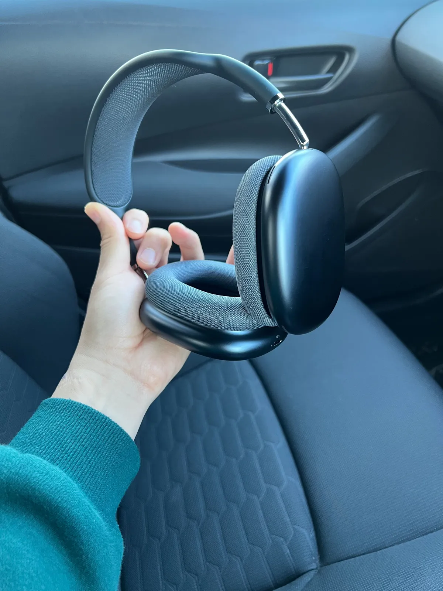

## 为什么换？

过去五年，我一直用着初代 AirPods Max 1（Lightning 版），用得挺好。外观上，头带有点松垮了，涂层也掉了，仰头或者挪动 Max 的位置时，还时不时会莫名其妙地断连，不过并没有太影响使用。

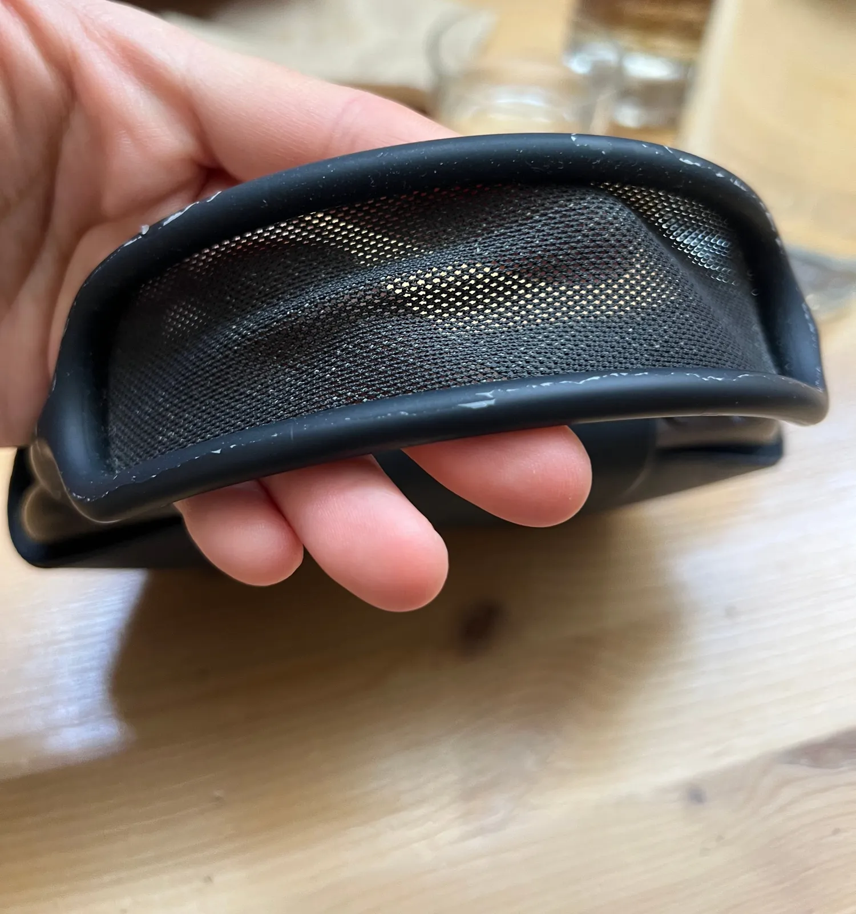
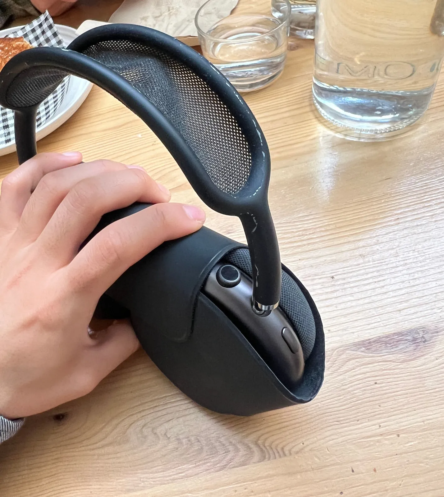

*Max 1 的外观磨损*

而且它的音质依然让我满意，这五年来，它一直是我可靠的……避风港？我超级超级超级喜欢在咖啡馆之类的地方干活（早上去咖啡馆是我最期待的时刻），在咖啡馆打开 MacBook、戴上这副耳机，我的世界就打开了。

今年第二代发布了，我时不时会想着要是能拥有就好了。最近去 Apple Store 亲自试听了一下，很中意，于是狠下心升级了。

 

## 音质

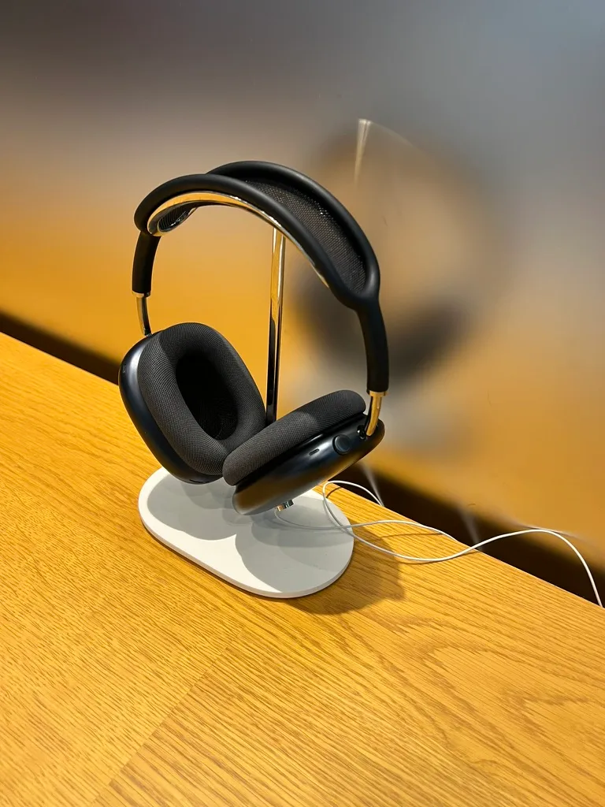

买之前我看了一些（其实是超级多）测评视频，有些 YouTuber 说听不出什么音质差别，可我自己在 Apple Store 试听时，明显感觉到声音很不一样。本来就很紧实的低频处理得更干净了，声音的分离度也变好了。最重要的是，中高频的提升让 headroom 好像一下子打开了，就算不开空间音频，也有一种头顶上方声音敞开的通透感。以前的 Max 1 高频像被削掉了一点，感觉天花板就压在我头顶上；现在没有天花板了，声音可以自由地向上散开。换句话说，音量开得很大耳朵也不疼！

整体的声音嘛……实在太好了，好到让我怀疑还有没有比这更好的。有个熟人说，这个钱不是可以买高端耳机了吗？但现在这个时代，流行音乐本来就是以 AirPods 为基准做出来的，如果我想用创作者工作时参考的耳机，那这反倒正是为我准备的产品。如果把音乐看作是和另一个世界的艺术家交流，那它不就是充当其中一条通道的参考级耳机吗？

 

## 苹果 - 电子产品公司？

我听到过这样的反应：苹果又不是专业音频公司，花 750 刀买它的耳机说得过去吗？嗯……

- Logic Pro（音乐制作）
- Apple Digital Masters（母带管理）
- iTunes（发行）
- Apple Music（流媒体）
- ALAC（自研无损编码）
- iPod
- Beats

这家公司对声音从来就没有不认真过。

 

## 第一印象

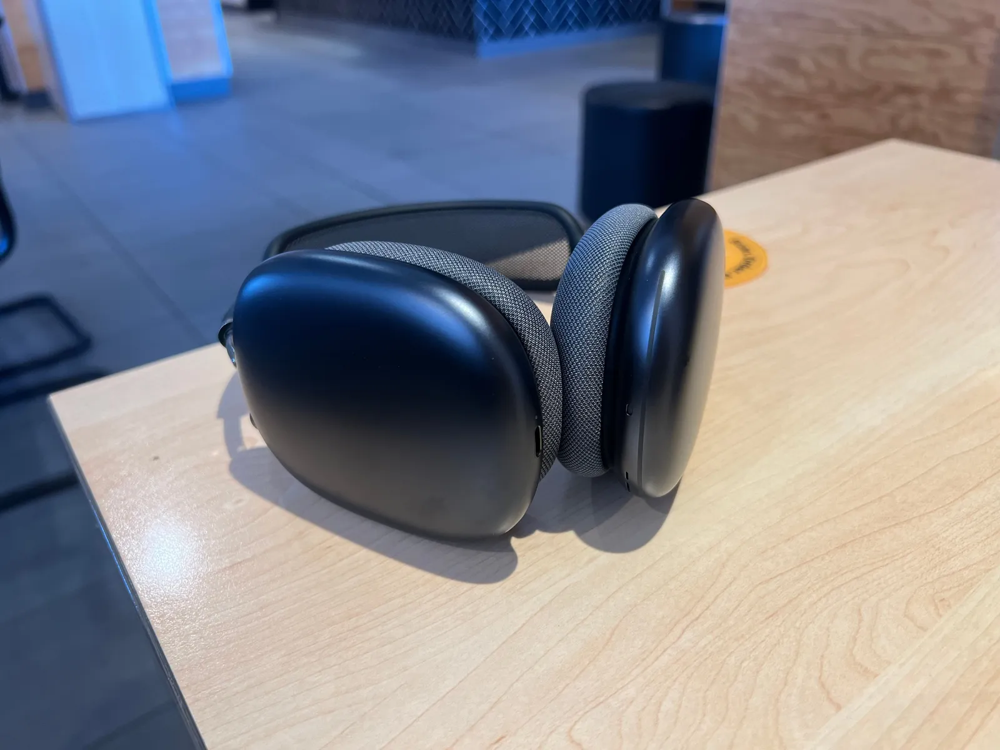

第一天 - 看着更像藏青色，这真的是“午夜色”吗？

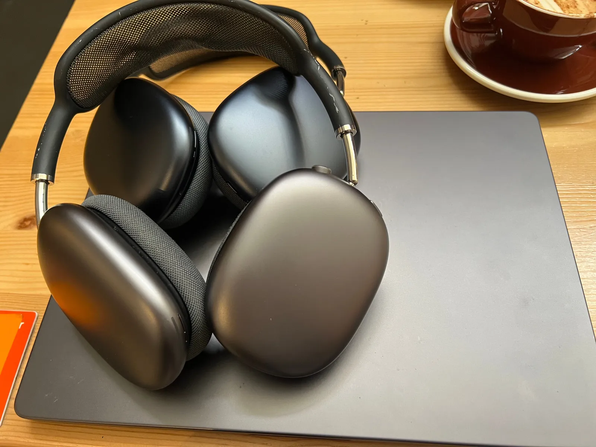

第二天 - Max 1 怎么这么黄？（背景是 M4 Pro 版 MacBook）

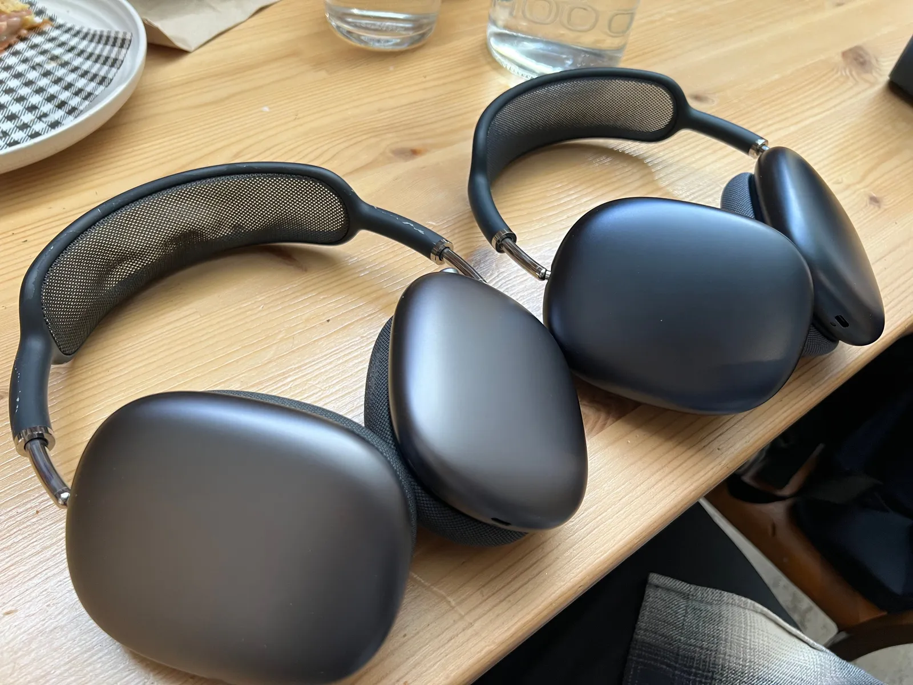

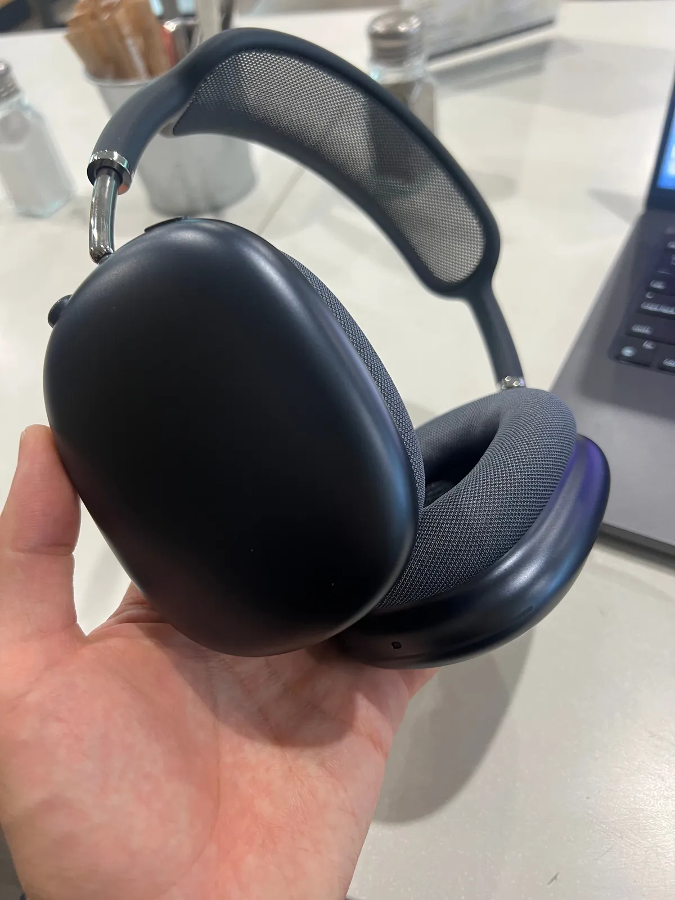

真的是午夜色！！哈哈哈
表面很光滑，随着光线能看到好几种颜色，我很满意。很高级。也可能是情人眼里出西施。

 

## 有线连接

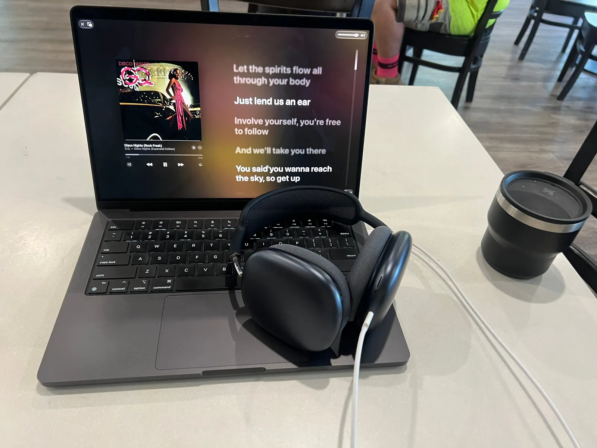

- 理线 - 以前用 Max 1 时也是接 Lightning &lt;-&gt; 3.5 mm 来听的，现在不需要了！MacBook 的 3.5 mm 插孔在左边，而 AirPods 的接口在右耳罩上，线得横着绕过去，很碍事。现在把 USB-C 插在 MacBook 右侧，线就只待在右边，干活方便多了。
- 音质 - Lightning 转 3.5 mm 会多一道音频处理，能感觉到声音特性有点变化、变得柔和。而这次的有线连接大概因为是数字传输，蓝牙特有的那种雾蒙蒙的感觉减轻了，不过声音特性和蓝牙几乎一样，所以有线连接的……乐趣？也就少了。
- 细节绝了 - 播放音乐时强行拔掉和 Mac 的连线，声音只断 0.2 秒，马上就切到蓝牙接着放。这都想到了？？？
- 转动表冠调的就是设备本身的音量。听起来理所当然，但以前用 3.5 mm 插孔时，电脑和 AirPods Max 各自的音量控制是分开的。

 

## H2 芯片，好

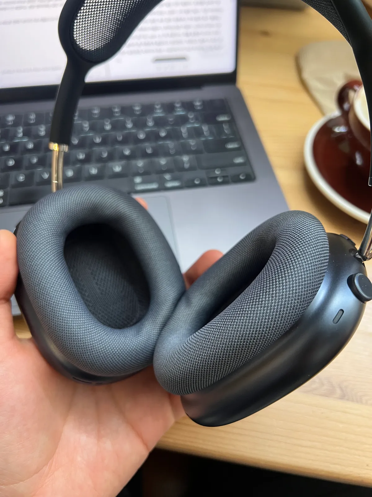

自适应降噪介于通透模式和降噪模式之间。以前用 AirPods Pro 3 时，要捏两下耳机柄才能从通透模式切到降噪模式，挺别扭的；现在只要按两下按键就行，很快就顺手了，很喜欢。

 

## 接口 - 降级了？

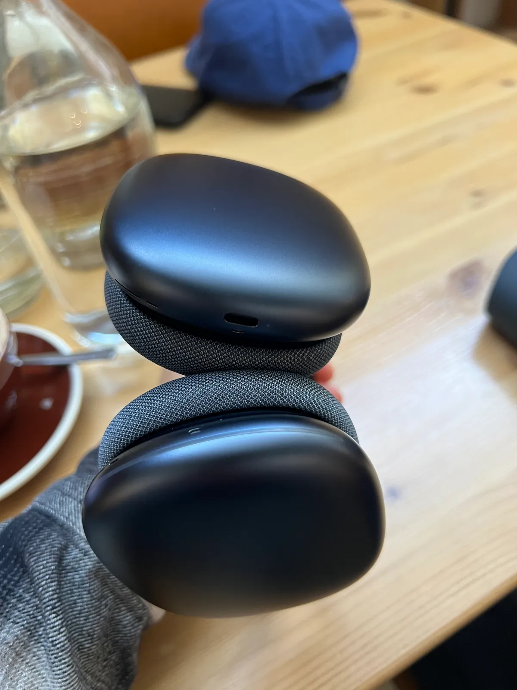

用 USB-C 是好事，但插进去的手感不太行。以前的 Lightning 虽然兼容性不怎么样，可充电头圆钝，插起来很顺滑；这个能感觉到金属特有的摩擦感，有点可惜。（不过用着用着好像越来越顺了。）USB-C 毕竟是标准，也不怪苹果。说实话，我觉得 Lightning 好得挺独特的。让我担心的是，接头末端已经沾上了像是磨下来的粉末，希望它能再好好用五年。

 

## 重量

也许是因为我头比较大，最重要的是，AirPods Max 对我来说没那么重。也不是说它轻。真是……感谢？我的大头。戴上专注起来就忘了重量。不过里面有点闷潮，所以每小时会摘下来歇一小会儿。

 

## 另外一些小变化

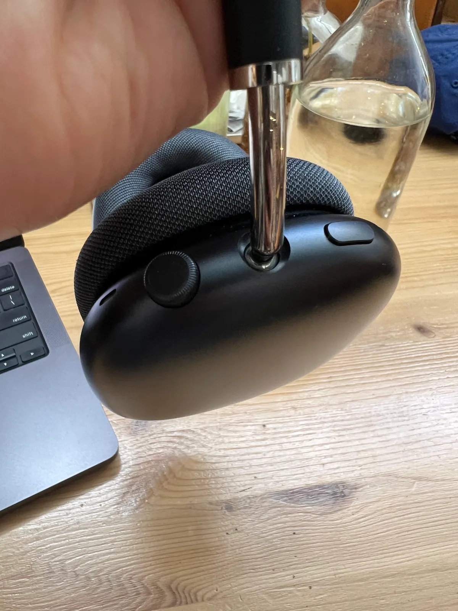

- 按键能按得更深一些。
- 头带变柔软了
- 转动耳罩的手感更沉稳了。

 

## 竞品

索尼和 Bose 还是能感觉到蓝牙耳机特有的那种雾蒙蒙的感觉，所以排除了……原因我也不清楚。我猜是不是 Apple Music - iPhone - AirPods 这个组合有什么特殊的音质处理。不过森海塞尔我试过，声音非常好。但也就是能和 AirPods 掰掰手腕的程度，价格还比 Max 贵一点（便利功能也没有）。

 

## 不会要出新款了吧？

我最担心的是，H2 芯片都出来四年了，那个年年都传的轻量版要是真的马上发布可怎么办？……可是这款也是今年五月才发布的，而且我看到它的销量太少了，苹果不太可能急着推出下一代轻量版 AirPods Max（据说只占 AirPods 总销量的 1% 左右），
再说苹果就是那个 HomePod 2018 年发布到现在设计都没改过、在改设计上尤其保守的公司嘛.. blah blah..，总之就是想要，所以买了！！

 

## 价格

说实话是有负担。但没有能替代它的耳机。都说它重，可考虑到铝金属材质的特性，也没什么好抱怨的。所以我在 Officeworks 按亚马逊的促销价再拿了 5% 的 price beat（比竞争对手价格再便宜 5%），把折扣吃到最大。问了问 Claude，它说苹果产品利润很薄，这个价可能非常接近批发价，甚至可能是亏本卖的。

*Officeworks 的价格 - 不过昨天黑五时一看，降到了 788 刀。这已经是最低价，估计享受不到 5% price beat 了。*

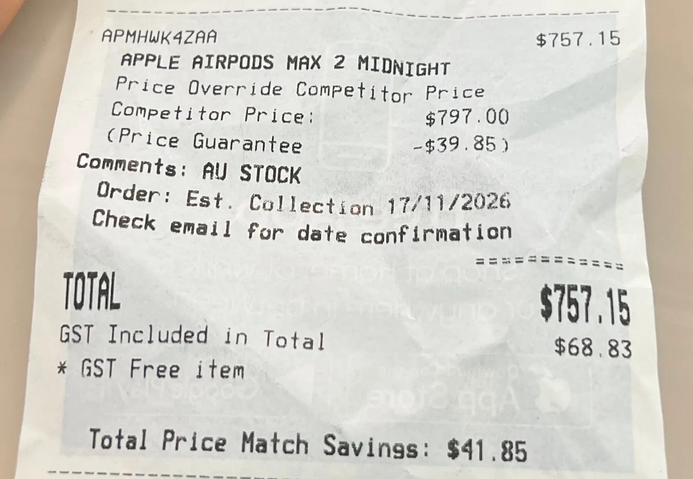

*Price beat 收据 - 谢谢你，Officeworks……*

 

## 推荐曲目

不用挑，什么都好听。
以前我会把歌分成适合空间音频的和不适合的来听，但在这副耳机上，即使默认关着，每首歌的空间感也都形成得很自然。非要选的话，K-pop 一类通常和空间音频不太搭，我推荐乐队音乐这种乐器能自然分开的歌。用它听 Prince 的 1999，会忍不住赞叹。

<AppleMusicButton href="https://music.apple.com/gb/album/1999-remastered/1479564716" label="收听 Prince - 1999 (Remastered)" />

 

## 结论

强烈推荐。
