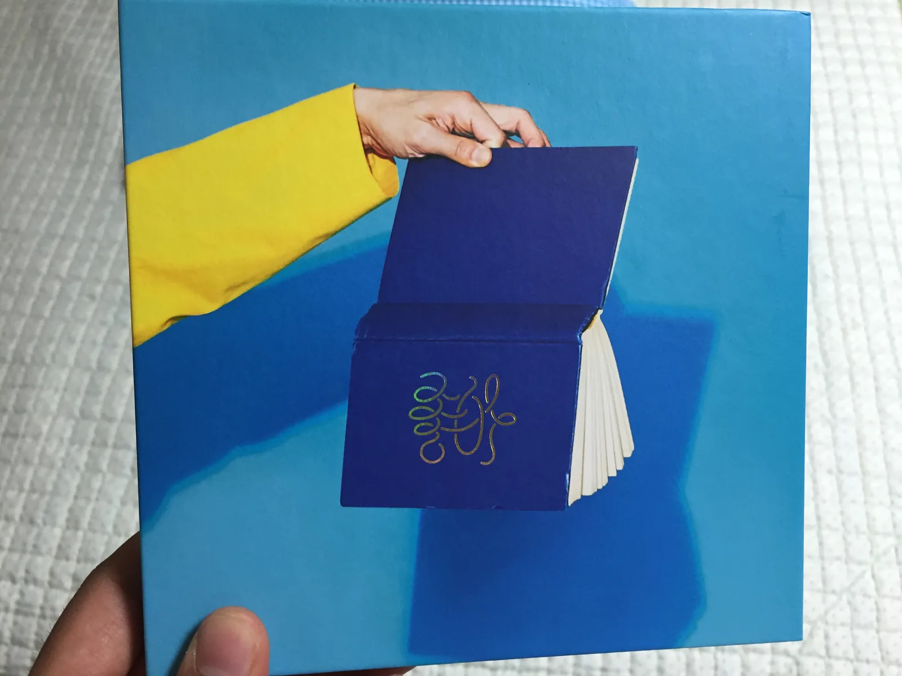
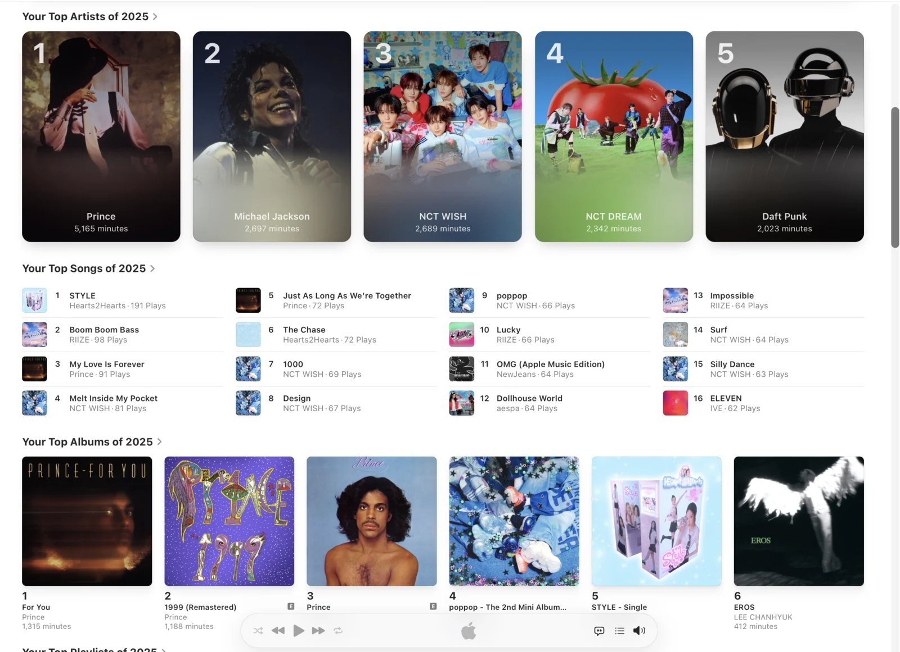
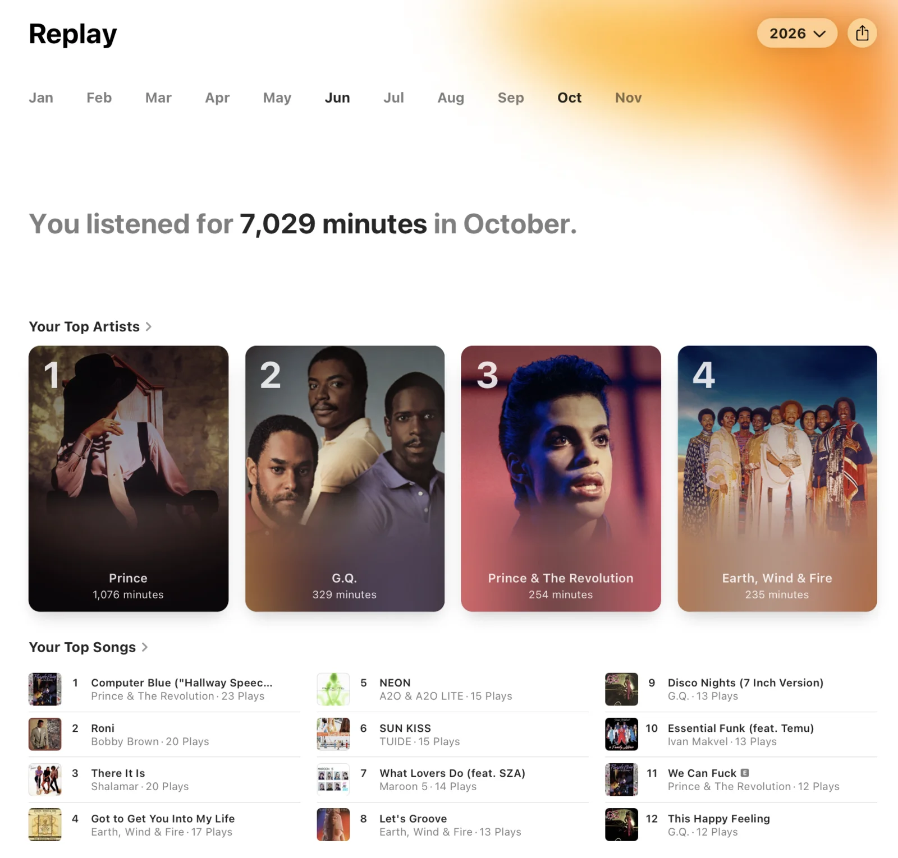

I used to be really into K-POP and Michael Jackson songs. With Michael Jackson, I was crazy about his solo albums Off the Wall and Thriller,
and in K-POP, I love songs with that strong, signature SM Ent production color.

Whenever someone asked what kind of music I liked, I'd usually just say SM Entertainment.

 

  <iframe
    src="https://www.youtube.com/embed/jmNhfjzmMrU"
    style="position:absolute;top:0;left:0;width:100%;height:100%;"
    frameborder="0"
    allowfullscreen>
  </iframe>

Back then I was also a huge fan of SHINee's Jonghyun. I still listen to him every now and then. I love the way his emotions feel close enough to touch, and the texture of his voice, all built on top of SM Entertainment's production.

 

  <iframe
    src="https://www.youtube.com/embed/x95oZNxW5Rc"
    style="position:absolute;top:0;left:0;width:100%;height:100%;"
    frameborder="0"
    allowfullscreen>
  </iframe>

In 2019, NCT's Superhuman really stuck with me. It still hits hard today. Anyway, that was the first time I'd heard a song that overwhelms you so directly, so high-voltage, so clean. I ended up looking up an interview with the composer on a YouTube channel called reacttothek.
In it, the composer said Chaka Khan's I Feel for You (1984) was one of the songs that inspired it, so I gave it a listen.

 

  <iframe
    src="https://www.youtube.com/embed/YW0sxgYAmLM"
    style="position:absolute;top:0;left:0;width:100%;height:100%;"
    frameborder="0"
    allowfullscreen>
  </iframe>

And isn't it insanely good? It's shocking even to me listening in 2026, so how shocking must it have been for people hearing it back in 1984? Apparently it went all the way to #1 on the Billboard R&B chart at the time. The music video is shocking too. Because it's that good. That excitement and the look in people's eyes back then!!

 

About six years passed after I first discovered Chaka Khan. I was chatting with Gemini about I Feel for You (asking, once again, how shocking the song must have been to the public back then lol). And what do you know, turns out this song is a cover? And the original's by Prince? So I listened to it right away.

  <iframe
    src="https://www.youtube.com/embed/XpEbyhWWa44"
    style="position:absolute;top:0;left:0;width:100%;height:100%;"
    frameborder="0"
    allowfullscreen>
  </iframe>

It's so good. So I started listening to Prince's second album, and wait, haven't I heard Sexy Dancer from this album somewhere before?

  <iframe
    src="https://www.youtube.com/embed/tARKDz_3wqc"
    style="position:absolute;top:0;left:0;width:100%;height:100%;"
    frameborder="0"
    allowfullscreen>
  </iframe>

It reminds me of Moses' Dangerous, which I used to love and listen to a lot. Feels like it sits somewhere between Jamiroquai and Sexy Dancer.

 

Back to Prince: so I started from his first album and have been listening like crazy, past Purple Rain and all the way to the Around the World in a Day album. A rambling love story with Prince that began with my K-POP.. Right now I'm up to Paisley Park from 1985, and they say the next one is his absolute peak, after the band broke up, but I'm not mentally ready, so I'm deliberately not listening yet..

 

All of 2025

October 2026

 

## Epilogue

  <iframe
    src="https://www.youtube.com/embed/uUhc8w0uhyg"
    style="position:absolute;top:0;left:0;width:100%;height:100%;"
    frameborder="0"
    allowfullscreen>
  </iframe>

On one of my nightly runs outside, I heard the drums of Lady Cab Driver and all his grievances pouring out over some woman moaning in the background, and loved it so much that I looked up a live version on YouTube, got overwhelmed by the music, my chest swelled up, and tears suddenly burst out right there on the street, and I was stunned at what I was even listening to. (I looked it up, and apparently this is called frisson.)

1999 really is a special album, even among all his albums.. I can't even begin to say how lucky I am, born a generation after him and getting to listen to his music as much as I want.

As much as his music, Prince is someone whose life story I love and feel so attached to. He's as human as he is contradictory.

 

  <iframe
    src="https://www.youtube.com/embed/Glpg6USuroQ"
    style="position:absolute;top:0;left:0;width:100%;height:100%;"
    frameborder="0"
    allowfullscreen>
  </iframe>

When it comes to his love life and his human side, I love Do Yourself a Favor. I've never heard a song this contradictory and this fun.
Please, just dump me and get lost! And then I wish you'd come to me.

 

  <iframe
    src="https://www.youtube.com/embed/R_nviNS0IAw"
    style="position:absolute;top:0;left:0;width:100%;height:100%;"
    frameborder="0"
    allowfullscreen>
  </iframe>

His deepest longing is Computer Blue (Hallway Speech Ver.). I think it's the first time I've heard a song that has me gripping so hard it feels like my hands could burn.. Listen with caution.

 

## Apple's Spatial Audio

For Prince's music, I always turn it on. A must if you use AirPods..
