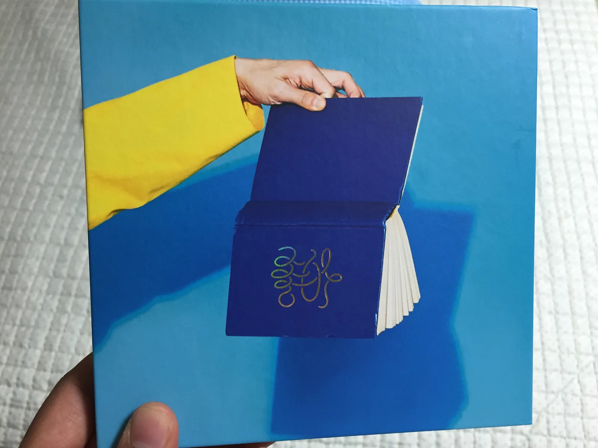
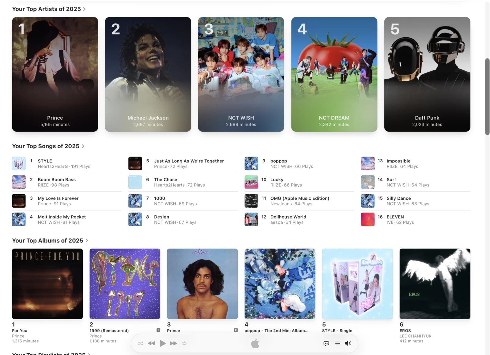
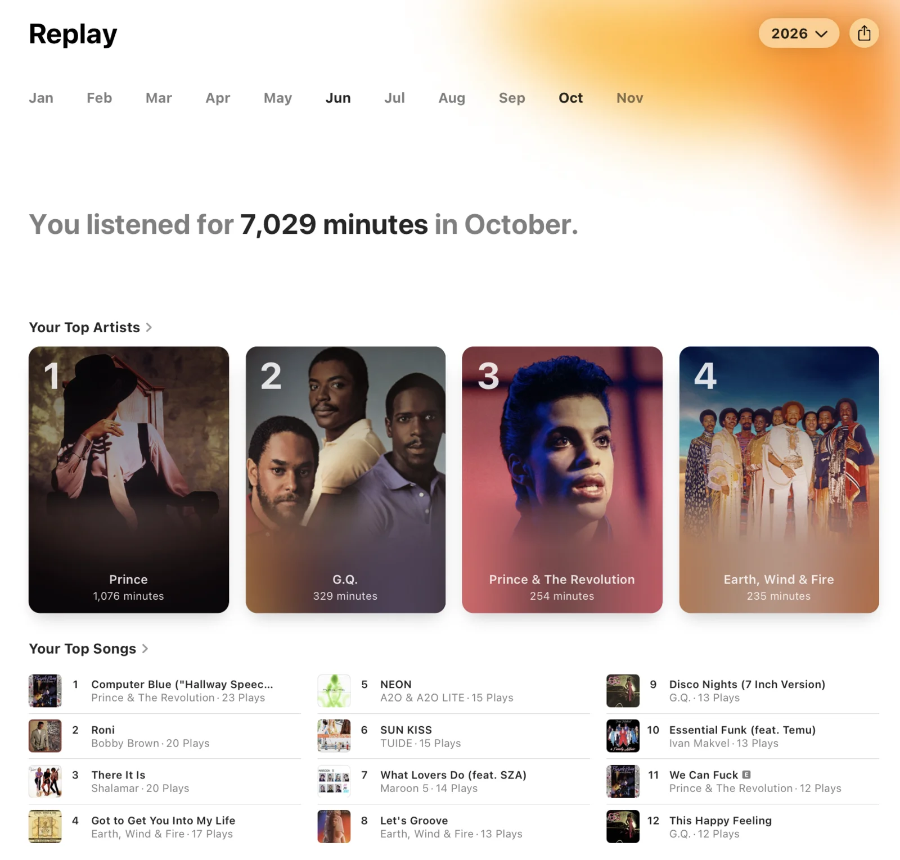

## K-POP

원래 나는 K-POP이나 마이클 잭슨 곡들을 유난히 좋아했다. 마이클 잭슨은 솔로 앨범 Off the Wall과 Thriller를 열광적으로 좋아했고,
K-POP에선 SM Ent 특유의 프로덕션 색이 강한 곡을 아주 좋아한다.

누가 어떤 곡을 좋아하는지 물으면, 보통 SM엔터테인먼트라고 했다.

 

  <iframe
    src="https://www.youtube.com/embed/jmNhfjzmMrU"
    style="position:absolute;top:0;left:0;width:100%;height:100%;"
    frameborder="0"
    allowfullscreen>
  </iframe>

당시 샤이니 종현도 엄청 좋아했다. 지금도 종종 듣는다. SM 엔터테인먼트의 프로덕션 위에 얹힌, 손에 닿을 듯한 그의 감정과 목소리의 질감이 좋다.

 

## 차카칸

  <iframe
    src="https://www.youtube.com/embed/x95oZNxW5Rc"
    style="position:absolute;top:0;left:0;width:100%;height:100%;"
    frameborder="0"
    allowfullscreen>
  </iframe>

2019년에 NCT의 Superhuman을 인상 깊게 들었다. 지금 들어도 인상적이다. 하튼 당시 이렇게 직빵으로, 고압으로, 깨끗하게 압도하는 곡을 처음 들었다. 나는 유튜브 reacttothek라는 채널에서 작곡가와 인터뷰 영상도 찾아보게 되었다.
이때 작곡가가 차카칸의 I Feel for You(1984)라는 곡이 영감이 된 곡 중 하나라고 해서 들어보게 되었다.

 

  <iframe
    src="https://www.youtube.com/embed/YW0sxgYAmLM"
    style="position:absolute;top:0;left:0;width:100%;height:100%;"
    frameborder="0"
    allowfullscreen>
  </iframe>

근데 이게 미친 듯이 좋은 거 아닌가? 지금 2026년에 듣는 나도 충격적인데, 당시 1984년에 이 곡을 들은 사람들은 얼마나 충격적이었을까? 당시 빌보드 R&B 차트 1위까지 한 곡이라고 한다. 뮤직비디오도 충격적임. 너무 좋아서. 당시 저 excitement와 사람들의 눈빛!!

 

## 프린스

그렇게 차카칸을 처음 알고 대략 6년이 지났다. I Feel for You라는 곡에 대해서 제미나이랑 대화 중이었다(똑같이 이 곡이 당시에 대중에게 얼마나 충격적이었는지 묻고 있었다 ㅋ). 근데 웬걸, 이 곡이 원곡이 있다고? 그게 프린스라고. 그래서 바로 들어봤다.

  <iframe
    src="https://www.youtube.com/embed/XpEbyhWWa44"
    style="position:absolute;top:0;left:0;width:100%;height:100%;"
    frameborder="0"
    allowfullscreen>
  </iframe>

엄청 좋다. 그래서 프린스 2집 앨범을 듣는데, 특히 이 앨범의 Sexy Dancer는 어디서 들어봤는데?

  <iframe
    src="https://www.youtube.com/embed/tARKDz_3wqc"
    style="position:absolute;top:0;left:0;width:100%;height:100%;"
    frameborder="0"
    allowfullscreen>
  </iframe>

내가 많이 듣던, 좋아하던 Moses의 Dangerous가 생각나네. 자미로콰이랑 Sexy Dancer의 중간 어딘가에 있는 곡 같다.

 

## Replay

다시 프린스로 돌아와서, 그렇게 1집부터 시작해서 퍼플레인 앨범을 지나 Around the World in a Day 앨범까지 미친 듯이 들어오고 있다. K-POP에서 시작해 두서없이 이어진, 나의 프린스 사랑 서사다.. 지금 1985년의 Paisley Park까지 듣고 있는데, 이다음이 밴드 해체 후 최전성기 앨범이라는데 마음의 준비가 안 되어서 일부러 곡을 안 듣고 있다..

 

*2025년 전체*

*2026년 10월 (아직 올해 전체 본이 안 나왔다)*

 

## 에필로그

  <iframe
    src="https://www.youtube.com/embed/uUhc8w0uhyg"
    style="position:absolute;top:0;left:0;width:100%;height:100%;"
    frameborder="0"
    allowfullscreen>
  </iframe>

야외 야간 러닝 중에 Lady Cab Driver의 드럼 소리와, 배경에 깔린 웬 여성의 신음 소리 위로 쏟아지는 그의 불만들을 듣고 너무 좋아서 유튜브에서 라이브 버전을 찾아 들었는데, 음악에 압도당해 가슴이 너무 벅차올라 길에서 눈물이 왈칵 쏟아지며, 내가 뭘 듣고 있는 건지 놀라기도 했다. (검색해 보니 이런 걸 프리송(frisson)이라고 한다고.)

1999는 정말 그의 앨범들 중에서도 특별한 앨범이다.. 그보다 한 세대 뒤에 태어나서 그의 음악을 마음껏 들을 수 있는 나는 정말 얼마만큼 행운인 사람인지 모른다.

프린스는 음악만큼이나 인생사도 내가 너무 좋아하고 정이 가는 사람이다. 그는 모순되는 만큼 인간적인 사람이다.

 

  <iframe
    src="https://www.youtube.com/embed/Glpg6USuroQ"
    style="position:absolute;top:0;left:0;width:100%;height:100%;"
    frameborder="0"
    allowfullscreen>
  </iframe>

그의 연애와 인간적인 면에서는 Do Yourself a Favor를 좋아한다. 이렇게 모순되고 즐거운 곡을 나는 들어본 적이 없다.

> 제발 나를 버리고 꺼져버려! 그리고 내게 와줬으면 좋겠어.

 

  <iframe
    src="https://www.youtube.com/embed/R_nviNS0IAw"
    style="position:absolute;top:0;left:0;width:100%;height:100%;"
    frameborder="0"
    allowfullscreen>
  </iframe>

그의 깊은 열망이 담긴 곡은 Computer Blue (Hallway Speech Ver.)다. 음악을 듣는데 이렇게 손이 델 것 같이 그립을 꽉 쥐는 곡은 처음 들어보는 듯.. 듣기에 주의가 필요하다.

 

## 애플의 스페이셜 오디오

프린스 음악에서는 무조건 켠다. 에어팟을 쓴다면 필수..
