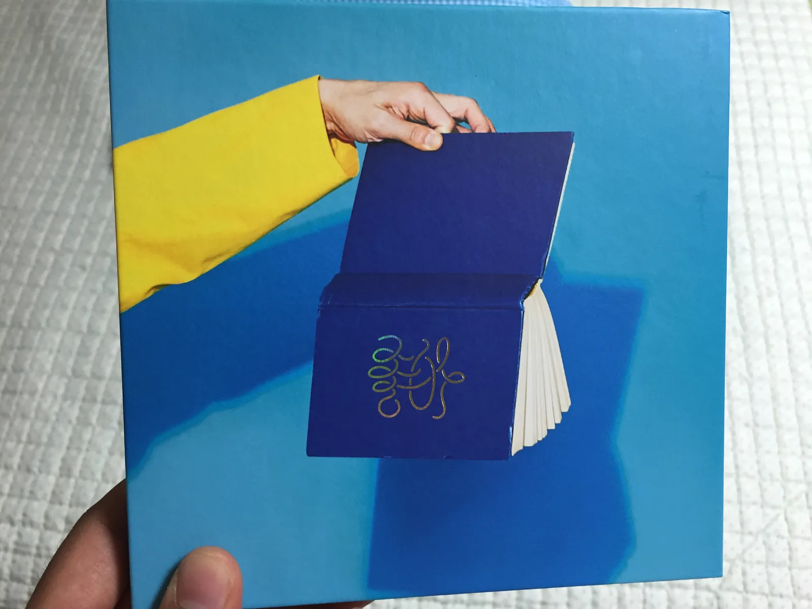
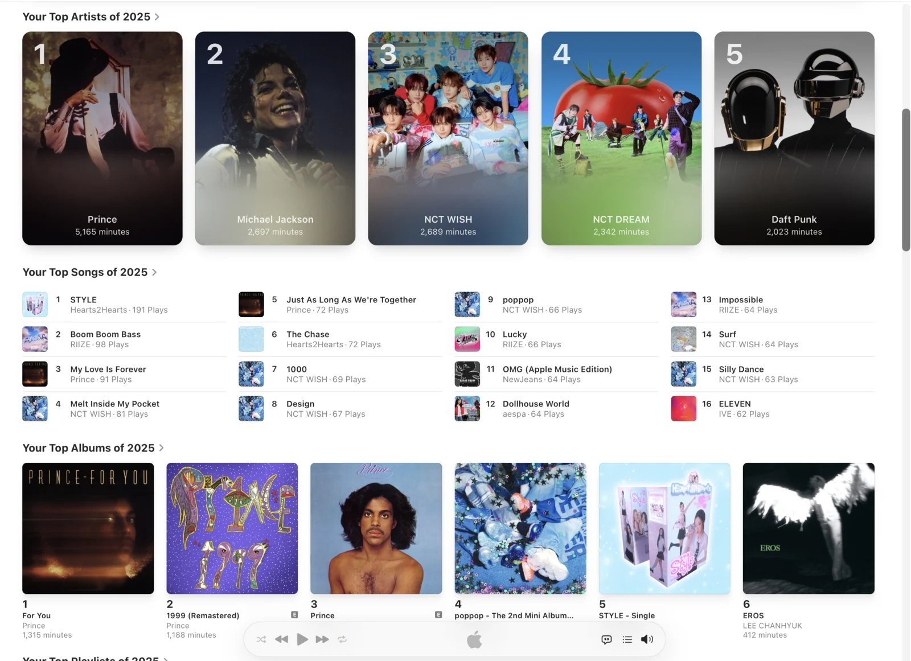
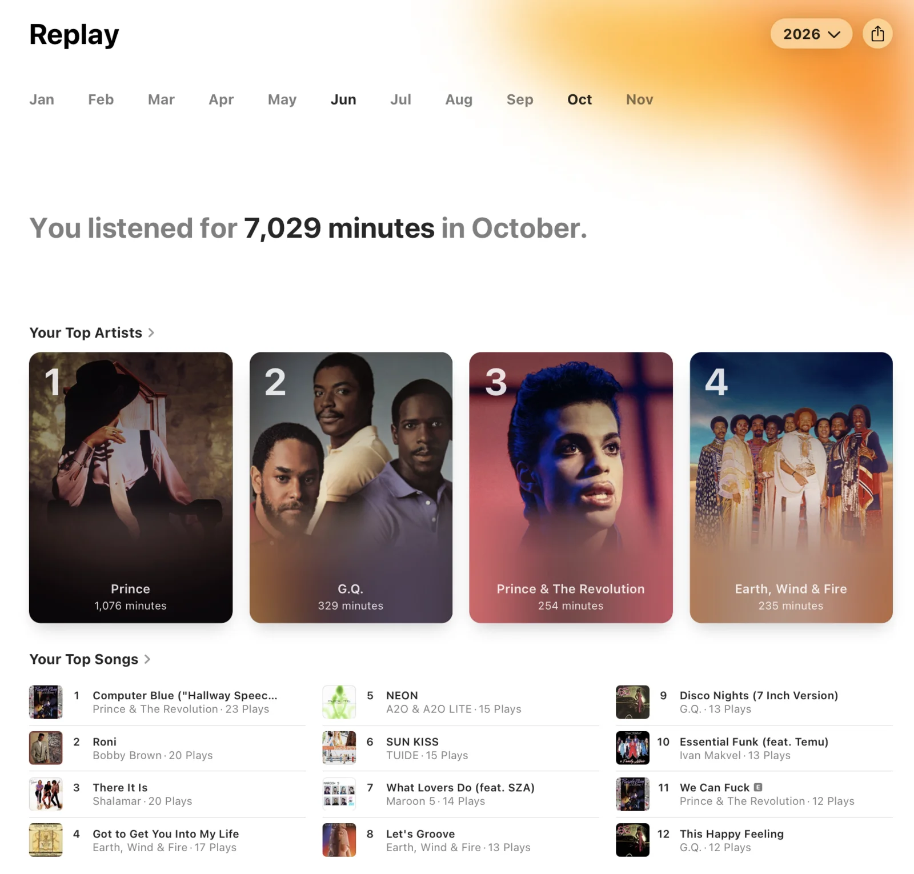

เดิมทีฉันชอบ K-POP กับเพลงของไมเคิล แจ็กสันเป็นพิเศษ ไมเคิล แจ็กสันนี่ฉันคลั่งอัลบั้มเดี่ยว Off the Wall กับ Thriller สุด ๆ
ส่วน K-POP ฉันชอบเพลงที่มีสีสันโปรดักชันเข้มข้นแบบเฉพาะตัวของ SM Ent มาก

เวลามีคนถามว่าชอบเพลงแบบไหน ปกติฉันจะตอบว่า SM Entertainment

 

  <iframe
    src="https://www.youtube.com/embed/jmNhfjzmMrU"
    style="position:absolute;top:0;left:0;width:100%;height:100%;"
    frameborder="0"
    allowfullscreen>
  </iframe>

ตอนนั้นฉันก็ชอบจงฮยอนวง SHINee มาก ๆ ตอนนี้ก็ยังฟังอยู่บ้างเป็นครั้งคราว บนพื้นฐานโปรดักชันของ SM Entertainment ฉันชอบอารมณ์ที่เหมือนเอื้อมมือไปแตะได้ของเขา กับเนื้อเสียงของเขา

 

  <iframe
    src="https://www.youtube.com/embed/x95oZNxW5Rc"
    style="position:absolute;top:0;left:0;width:100%;height:100%;"
    frameborder="0"
    allowfullscreen>
  </iframe>

ปี 2019 ฉันประทับใจ Superhuman ของ NCT มาก ตอนนี้ฟังก็ยังประทับใจอยู่ ยังไงก็ตาม นั่นเป็นครั้งแรกที่ฉันได้ฟังเพลงที่ถล่มคนฟังแบบตรง ๆ แรงดันสูง แถมคลีนขนาดนี้ ฉันเลยไปตามดูคลิปสัมภาษณ์นักแต่งเพลงในช่อง YouTube ชื่อ reacttothek
ตอนนั้นนักแต่งเพลงบอกว่า I Feel for You (1984) ของ Chaka Khan เป็นหนึ่งในเพลงที่เป็นแรงบันดาลใจ ฉันเลยลองไปฟังดู

 

  <iframe
    src="https://www.youtube.com/embed/YW0sxgYAmLM"
    style="position:absolute;top:0;left:0;width:100%;height:100%;"
    frameborder="0"
    allowfullscreen>
  </iframe>

แต่นี่มันดีแบบบ้าคลั่งเลยไม่ใช่เหรอ? ขนาดฉันฟังในปี 2026 ยังช็อก แล้วคนที่ได้ฟังเพลงนี้ตอนปี 1984 จะช็อกขนาดไหน? ว่ากันว่าตอนนั้นขึ้นไปถึงอันดับ 1 ชาร์ต Billboard R&B เลย MV ก็ช็อก เพราะมันดีเกินไป excitement และสายตาของผู้คนในตอนนั้น!!

 

จากนั้นก็ผ่านไปราว 6 ปีนับจากที่รู้จัก Chaka Khan ครั้งแรก ฉันกำลังคุยกับ Gemini เรื่องเพลง I Feel for You (ถามเหมือนเดิมเลยว่าเพลงนี้สร้างความช็อกให้คนทั่วไปในตอนนั้นแค่ไหน 555) แต่ใครจะไปคิด เพลงนี้มีต้นฉบับด้วยเหรอ? ของ Prince งั้นเหรอ? ฉันเลยไปฟังทันที

  <iframe
    src="https://www.youtube.com/embed/XpEbyhWWa44"
    style="position:absolute;top:0;left:0;width:100%;height:100%;"
    frameborder="0"
    allowfullscreen>
  </iframe>

ดีมาก ฉันเลยฟังอัลบั้มที่สองของ Prince และโดยเฉพาะเพลง Sexy Dancer ในอัลบั้มนี้ เหมือนเคยได้ยินที่ไหนมาก่อนนะ?

  <iframe
    src="https://www.youtube.com/embed/tARKDz_3wqc"
    style="position:absolute;top:0;left:0;width:100%;height:100%;"
    frameborder="0"
    allowfullscreen>
  </iframe>

ทำให้นึกถึง Dangerous ของ Moses ที่ฉันเคยชอบและฟังบ่อยมาก รู้สึกเหมือนเป็นเพลงที่อยู่ตรงไหนสักแห่งระหว่าง Jamiroquai กับ Sexy Dancer

 

กลับมาที่ Prince อีกครั้ง ฉันเริ่มจากอัลบั้มแรก ผ่าน Purple Rain มา และฟังแบบบ้าคลั่งมาจนถึงอัลบั้ม Around the World in a Day เรื่องราวความรักที่มีต่อ Prince แบบไร้ทิศทาง ที่เริ่มต้นจาก K-POP ของฉัน.. ตอนนี้ฟังมาถึง Paisley Park ปี 1985 แล้ว ได้ยินว่าอัลบั้มถัดไปคือช่วงพีคที่สุดของเขาหลังวงแตก แต่ฉันยังไม่พร้อมทำใจ เลยจงใจยังไม่ฟัง..

 

ทั้งปี 2025

ตุลาคม 2026

 

## บทส่งท้าย

  <iframe
    src="https://www.youtube.com/embed/uUhc8w0uhyg"
    style="position:absolute;top:0;left:0;width:100%;height:100%;"
    frameborder="0"
    allowfullscreen>
  </iframe>

ระหว่างวิ่งกลางแจ้ง ฉันได้ยินเสียงกลองของ Lady Cab Driver กับความไม่พอใจสารพัดของเขาที่พรั่งพรูออกมาบนเสียงครางของผู้หญิงสักคนที่ดังอยู่เป็นแบ็กกราวด์ ชอบมากจนไปหาเวอร์ชันไลฟ์ใน YouTube มาฟัง แล้วก็ถูกดนตรีถล่มจนอกตื้นตันไปหมด น้ำตาไหลพรากออกมากลางถนน จนตกใจว่านี่ฉันกำลังฟังอะไรอยู่เนี่ย (ลองค้นดูแล้ว เขาเรียกอาการแบบนี้ว่า frisson)

1999 เป็นอัลบั้มที่พิเศษจริง ๆ แม้แต่ในบรรดาอัลบั้มทั้งหมดของเขา.. ฉันที่เกิดหลังเขาหนึ่งรุ่นและได้ฟังเพลงของเขาได้เต็มที่ ไม่รู้เลยว่าตัวเองโชคดีแค่ไหน

Prince เป็นคนที่ไม่ใช่แค่ดนตรี แต่เรื่องราวชีวิตของเขาฉันก็ชอบมากและรู้สึกผูกพัน เขาย้อนแย้งมากเท่าไร ก็เป็นมนุษย์มากเท่านั้น

 

  <iframe
    src="https://www.youtube.com/embed/Glpg6USuroQ"
    style="position:absolute;top:0;left:0;width:100%;height:100%;"
    frameborder="0"
    allowfullscreen>
  </iframe>

ในแง่ความรักและด้านความเป็นมนุษย์ของเขา ฉันชอบ Do Yourself a Favor ฉันไม่เคยฟังเพลงที่ย้อนแย้งและสนุกขนาดนี้มาก่อน
ได้โปรดทิ้งฉันแล้วไปให้พ้น! แล้วก็อยากให้เธอกลับมาหาฉัน

 

  <iframe
    src="https://www.youtube.com/embed/R_nviNS0IAw"
    style="position:absolute;top:0;left:0;width:100%;height:100%;"
    frameborder="0"
    allowfullscreen>
  </iframe>

ความปรารถนาลึก ๆ ของเขาคือ Computer Blue (Hallway Speech Ver.) เหมือนเป็นครั้งแรกที่ได้ฟังเพลงที่ทำให้กำมือแน่นจนรู้สึกเหมือนมือจะพอง.. ควรฟังด้วยความระมัดระวัง

 

## Spatial Audio ของ Apple

ฟังเพลงของ Prince เมื่อไรต้องเปิดเสมอ ถ้าใช้ AirPods อยู่ล่ะก็ ขาดไม่ได้เลย..
