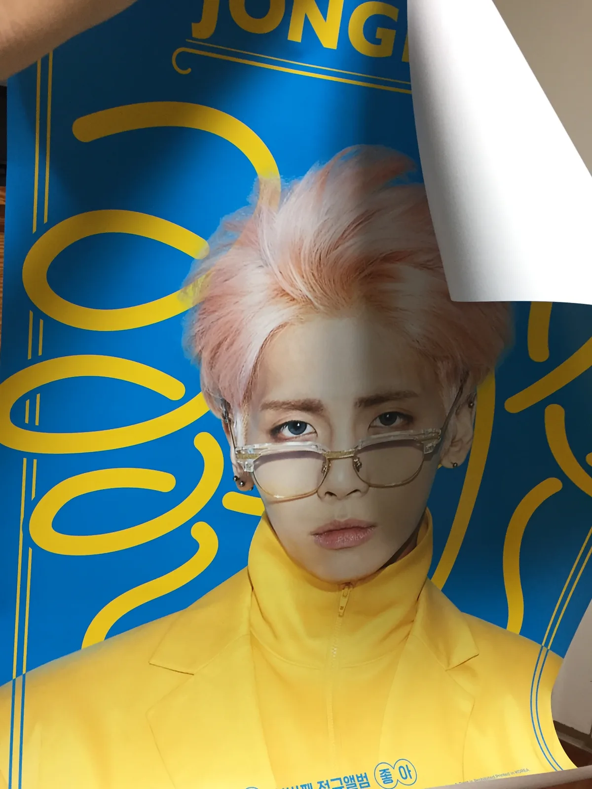
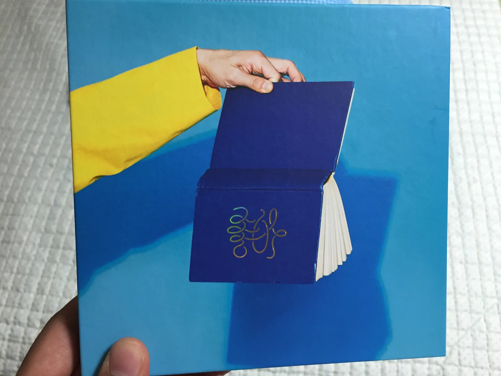
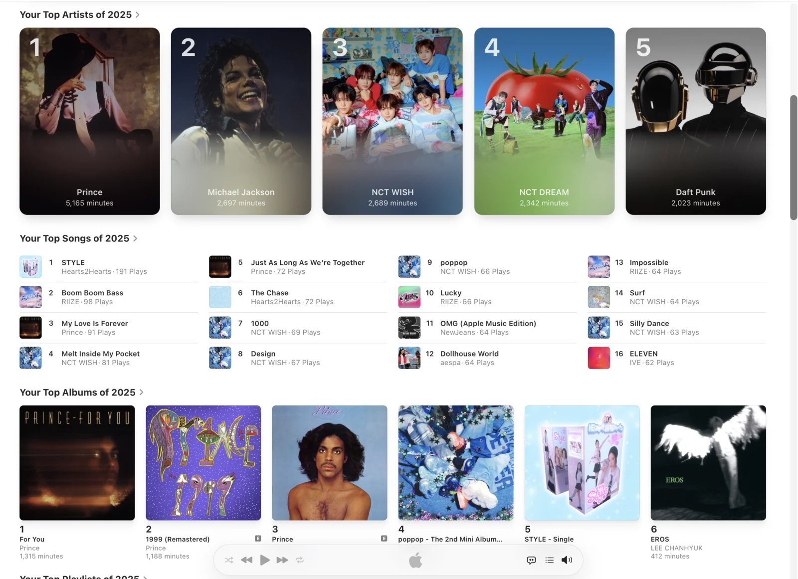
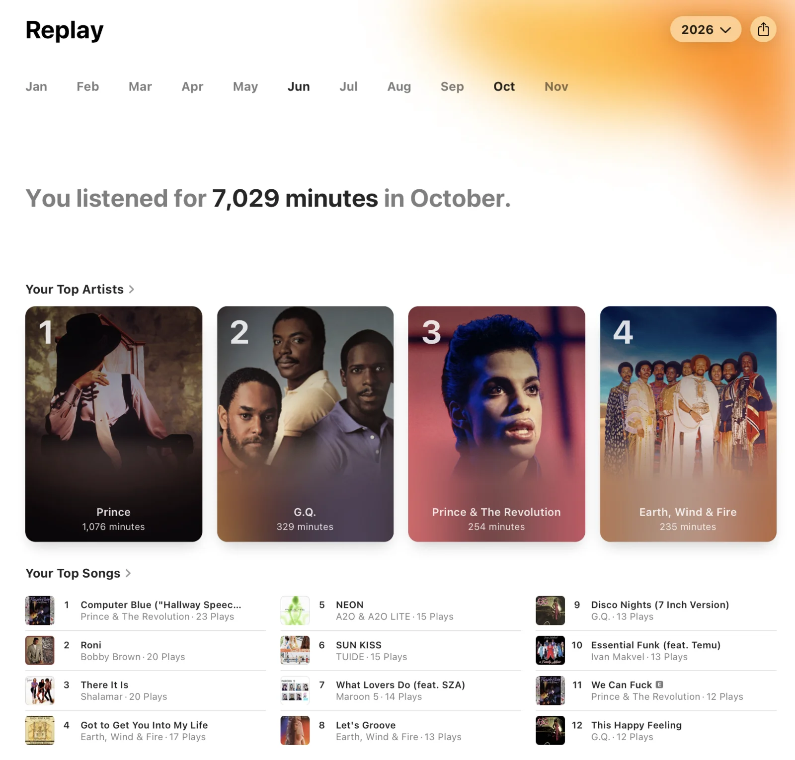

Trước đây tôi đặc biệt thích K-POP và nhạc của Michael Jackson. Với Michael Jackson, tôi mê cuồng nhiệt hai album solo Off the Wall và Thriller,
còn trong K-POP, tôi rất thích những bài mang màu sản xuất đậm chất riêng của SM Ent.

Ai hỏi tôi thích bài kiểu gì, tôi thường trả lời là SM Entertainment.

 

  <iframe
    src="https://www.youtube.com/embed/jmNhfjzmMrU"
    style="position:absolute;top:0;left:0;width:100%;height:100%;"
    frameborder="0"
    allowfullscreen>
  </iframe>

Hồi đó tôi cũng cực kỳ thích Jonghyun của SHINee. Giờ thỉnh thoảng vẫn nghe.

 

  <iframe
    src="https://www.youtube.com/embed/x95oZNxW5Rc"
    style="position:absolute;top:0;left:0;width:100%;height:100%;"
    frameborder="0"
    allowfullscreen>
  </iframe>

Năm 2017, Superhuman của NCT để lại ấn tượng rất sâu với tôi. Giờ nghe lại vẫn thấy ấn tượng. Dù sao thì, đó là lần đầu tiên tôi nghe một bài áp đảo người nghe thẳng tưng, cao áp và sạch sẽ đến vậy. Tôi còn lên một kênh YouTube tên reacttothek để tìm xem video phỏng vấn nhạc sĩ sáng tác.
Lúc đó nhạc sĩ nói I Feel for You (1984) của Chaka Khan là một trong những bài đã truyền cảm hứng, nên tôi nghe thử.

 

  <iframe
    src="https://www.youtube.com/embed/YW0sxgYAmLM"
    style="position:absolute;top:0;left:0;width:100%;height:100%;"
    frameborder="0"
    allowfullscreen>
  </iframe>

Mà bài này hay điên lên được ấy chứ? Đến tôi nghe vào năm 2026 còn thấy sốc, thì những người nghe bài này hồi năm 1984 chắc sốc đến mức nào? Nghe nói đây là bài có rap đã leo lên tận hạng 1 bảng xếp hạng Billboard R&B. MV cũng sốc. Vì hay quá. Ánh mắt excitement và tập trung hồi đó!!

 

Thế là khoảng 6 năm trôi qua kể từ lần đầu biết Chaka Khan. Tôi đang nói chuyện với Gemini về bài I Feel for You (lại hỏi y như cũ là bài này hồi đó gây sốc cho công chúng cỡ nào haha). Thế mà ai ngờ, bài này có bản gốc á? Là của Prince á? Thế là tôi nghe ngay.

  <iframe
    src="https://www.youtube.com/embed/XpEbyhWWa44"
    style="position:absolute;top:0;left:0;width:100%;height:100%;"
    frameborder="0"
    allowfullscreen>
  </iframe>

Hay cực. Thế là tôi nghe album thứ hai của Prince, mà đặc biệt bài Sexy Dancer trong album này, hình như nghe ở đâu rồi thì phải?

  <iframe
    src="https://www.youtube.com/embed/tARKDz_3wqc"
    style="position:absolute;top:0;left:0;width:100%;height:100%;"
    frameborder="0"
    allowfullscreen>
  </iframe>

Làm tôi nhớ đến Dangerous của Moses, bài tôi từng thích và nghe rất nhiều. Cảm giác như một bài nằm đâu đó giữa Jamiroquai và Sexy Dancer.

 

Quay lại với Prince, cứ thế tôi bắt đầu từ album đầu tiên, đi qua Purple Rain, và nghe như điên cho đến giờ. Câu chuyện tình yêu với Prince, lộn xộn chẳng đầu chẳng đuôi, bắt đầu từ K-POP của tôi.. Giờ tôi đang nghe đến Paisley Park năm 1985, nghe nói album tiếp theo là đỉnh cao nhất của anh ấy mà tôi chưa chuẩn bị tinh thần, nên cố tình chưa nghe..

 

Cả năm 2025

Tháng 10 năm 2026

 

## Lời kết

  <iframe
    src="https://www.youtube.com/embed/uUhc8w0uhyg"
    style="position:absolute;top:0;left:0;width:100%;height:100%;"
    frameborder="0"
    allowfullscreen>
  </iframe>

Đang chạy bộ ngoài trời, tôi nghe tiếng trống của Lady Cab Driver và những lời bất mãn của anh ấy tuôn ra trên tiếng rên của một người phụ nữ, thích quá nên lên YouTube tìm bản live nghe, rồi bị âm nhạc áp đảo, ngực dâng trào đến nghẹn, nước mắt bỗng tuôn ào ra ngay giữa đường, đến mức tôi giật mình không biết mình đang nghe cái gì nữa. (Tra thử thì hình như cái này gọi là frisson.)

1999 thực sự là một album đặc biệt, kể cả trong số các album của anh ấy.. Sinh ra sau anh ấy một thế hệ và được nghe nhạc của anh ấy thỏa thích, tôi chẳng biết mình may mắn đến nhường nào.

Prince là người mà không chỉ âm nhạc, cả câu chuyện cuộc đời anh ấy tôi cũng rất thích và thấy thương. Anh ấy mâu thuẫn bao nhiêu thì cũng rất người bấy nhiêu.

 

  <iframe
    src="https://www.youtube.com/embed/Glpg6USuroQ"
    style="position:absolute;top:0;left:0;width:100%;height:100%;"
    frameborder="0"
    allowfullscreen>
  </iframe>

Về chuyện tình cảm và mặt con người của anh ấy, tôi thích Do Yourself a Favor. Tôi chưa từng nghe bài nào mâu thuẫn mà vui đến thế.
Làm ơn bỏ tôi đi và biến đi! Rồi mong em đến với tôi.

 

  <iframe
    src="https://www.youtube.com/embed/R_nviNS0IAw"
    style="position:absolute;top:0;left:0;width:100%;height:100%;"
    frameborder="0"
    allowfullscreen>
  </iframe>

Khao khát sâu thẳm của anh ấy là Computer Blue (Hallway Speech Ver.). Hình như lần đầu tôi nghe một bài khiến mình siết tay chặt đến mức tưởng như sắp bỏng tay.. Cần thận trọng khi nghe.

 

## Âm thanh không gian của Apple

Nghe nhạc Prince là tôi bật bằng mọi giá. Nếu dùng AirPods thì bắt buộc..
