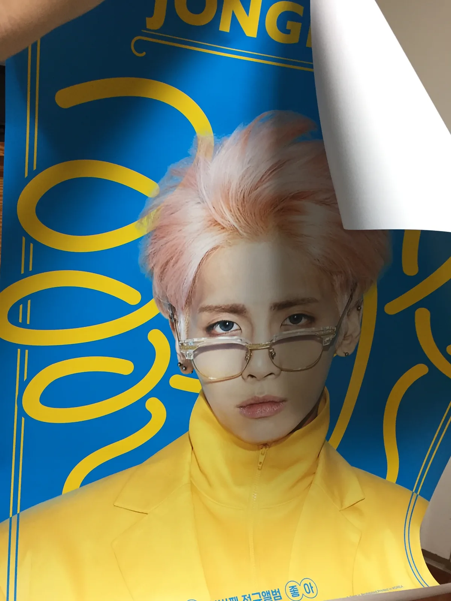
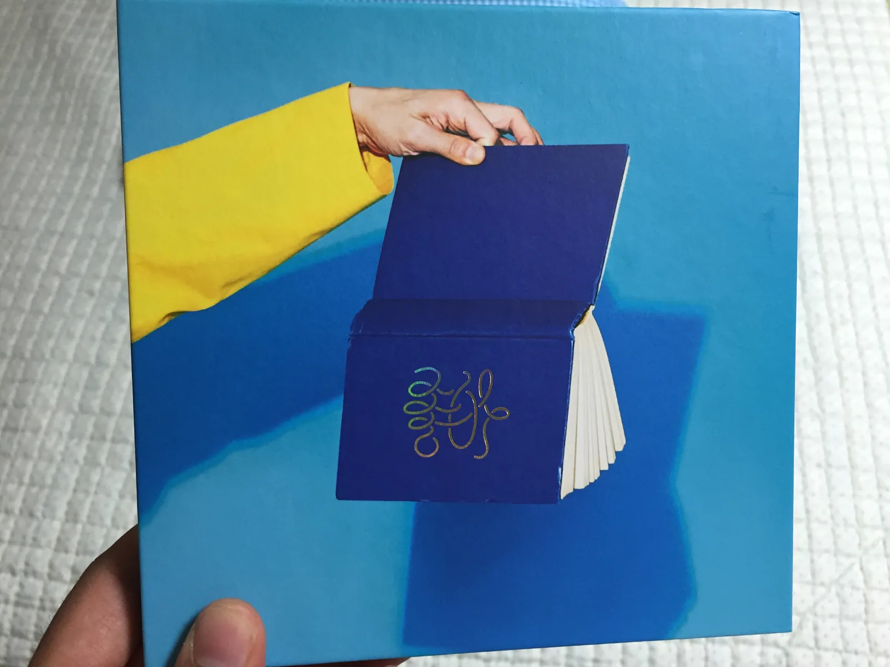
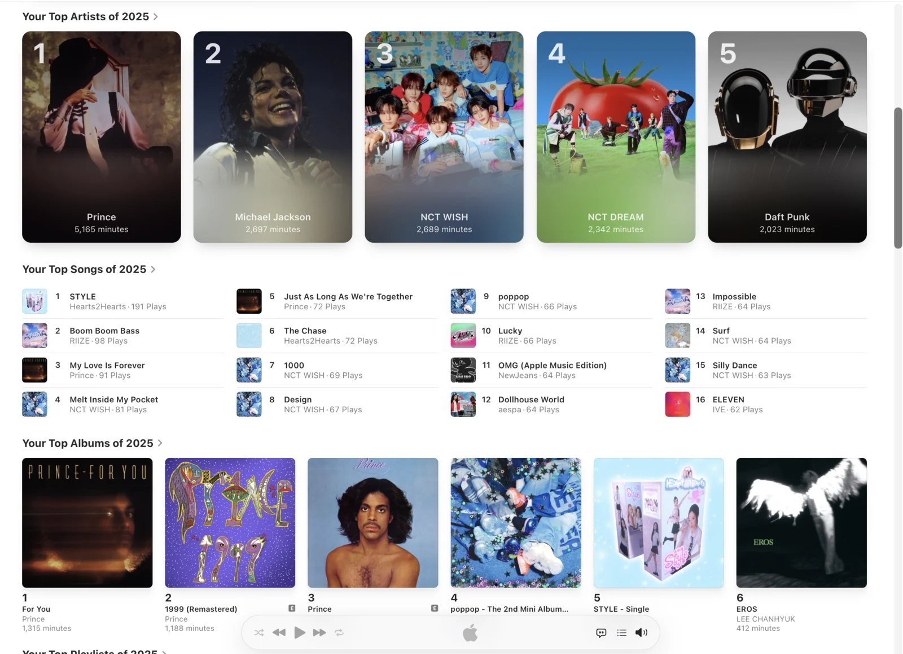
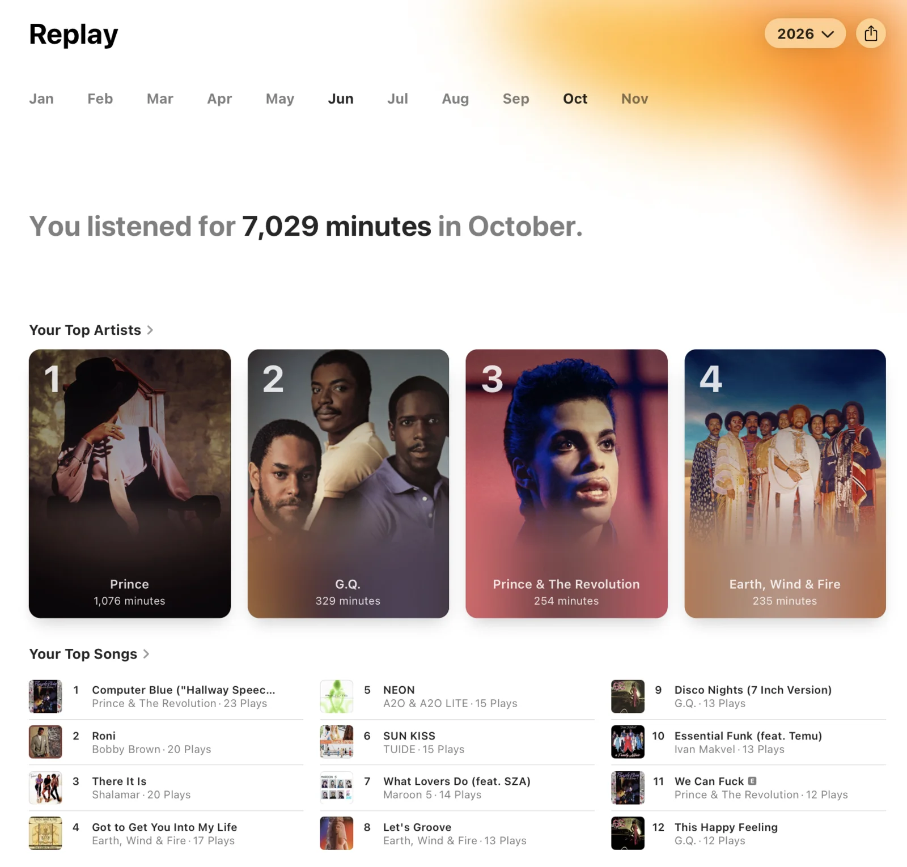

我原本特别喜欢 K-POP 和迈克尔·杰克逊的歌。迈克尔·杰克逊的话，我狂热地喜欢他的个人专辑 Off the Wall 和 Thriller，
K-POP 里，我非常喜欢带有 SM Ent 独特、浓烈制作色彩的歌。

有人问我喜欢什么样的歌，我通常会说 SM 娱乐。

 

  <iframe
    src="https://www.youtube.com/embed/jmNhfjzmMrU"
    style="position:absolute;top:0;left:0;width:100%;height:100%;"
    frameborder="0"
    allowfullscreen>
  </iframe>

那时候我也超级喜欢 SHINee 的钟铉。现在也还时不时会听。

 

  <iframe
    src="https://www.youtube.com/embed/x95oZNxW5Rc"
    style="position:absolute;top:0;left:0;width:100%;height:100%;"
    frameborder="0"
    allowfullscreen>
  </iframe>

2017 年，NCT 的 Superhuman 给我留下了很深的印象。现在听也还是很震撼。总之，那是我第一次听到这样直击要害、高压、干净利落地把人压倒的歌。我还在 YouTube 一个叫 reacttothek 的频道上找了作曲家的采访视频来看。
当时作曲家说，Chaka Khan 的 I Feel for You（1984）是给他灵感的歌之一，于是我就去听了。

 

  <iframe
    src="https://www.youtube.com/embed/YW0sxgYAmLM"
    style="position:absolute;top:0;left:0;width:100%;height:100%;"
    frameborder="0"
    allowfullscreen>
  </iframe>

可这也好听得太疯狂了吧？连 2026 年听的我都觉得震撼，1984 年当时听到这首歌的人该有多震撼啊？据说这是一首带说唱、一路冲到 Billboard R&B 榜第一的歌。MV 也很震撼。因为太好了。当时那种 excitement 和专注的眼神！！

 

就这样，从第一次知道 Chaka Khan 起大约过了 6 年。我在和 Gemini 聊 I Feel for You 这首歌（又一次在问这首歌当时对大众有多震撼 哈）。结果没想到，这首歌居然有原曲？原唱是 Prince？于是我马上就去听了。

  <iframe
    src="https://www.youtube.com/embed/XpEbyhWWa44"
    style="position:absolute;top:0;left:0;width:100%;height:100%;"
    frameborder="0"
    allowfullscreen>
  </iframe>

超好听。于是我开始听 Prince 的第二张专辑，尤其是这张专辑里的 Sexy Dancer，我是不是在哪儿听过？

  <iframe
    src="https://www.youtube.com/embed/tARKDz_3wqc"
    style="position:absolute;top:0;left:0;width:100%;height:100%;"
    frameborder="0"
    allowfullscreen>
  </iframe>

让我想起了我以前常听、很喜欢的 Moses 的 Dangerous。感觉是介于 Jamiroquai 和 Sexy Dancer 之间的某首歌。

 

再回到 Prince，就这样我从第一张专辑开始，越过 Purple Rain，一路疯狂地听到现在。从我的 K-POP 开始、一路没头没脑地延续下来的对 Prince 的爱的故事.. 现在我听到了 1985 年的 Paisley Park，听说下一张就是他的巅峰专辑，可我还没做好心理准备，所以故意还没听..

 

2025 年全年

2026 年 10 月

 

## 尾声

  <iframe
    src="https://www.youtube.com/embed/uUhc8w0uhyg"
    style="position:absolute;top:0;left:0;width:100%;height:100%;"
    frameborder="0"
    allowfullscreen>
  </iframe>

在户外跑步时，听到 Lady Cab Driver 的鼓声，还有在女人的呻吟声上倾泻而出的他的种种不满，实在太喜欢了，就去 YouTube 找了现场版来听，结果被音乐压倒，胸口满到快要炸开，在路上眼泪一下子涌了出来，连我自己都被吓到：我到底在听什么啊。（搜了一下，据说这叫 frisson。）

1999 在他所有的专辑里也真的是很特别的一张.. 比他晚一代出生、能尽情听他音乐的我，真不知道自己有多幸运。

Prince 是一个我不只喜欢他的音乐、也非常喜欢他的人生故事、让我很有感情的人。他有多矛盾，就有多有人味。

 

  <iframe
    src="https://www.youtube.com/embed/Glpg6USuroQ"
    style="position:absolute;top:0;left:0;width:100%;height:100%;"
    frameborder="0"
    allowfullscreen>
  </iframe>

说到他的恋爱和人性的一面，我喜欢 Do Yourself a Favor。我从没听过这么矛盾又这么快乐的歌。
求你了，甩了我滚吧！然后希望你回到我身边。

 

  <iframe
    src="https://www.youtube.com/embed/R_nviNS0IAw"
    style="position:absolute;top:0;left:0;width:100%;height:100%;"
    frameborder="0"
    allowfullscreen>
  </iframe>

他深深的渴望是 Computer Blue (Hallway Speech Ver.)。好像是第一次听到一首让人把手握得那么紧、紧到像要烫伤的歌.. 收听需谨慎。

 

## 苹果的空间音频

听 Prince 的音乐时一定会开。如果你用 AirPods 的话，必备..
